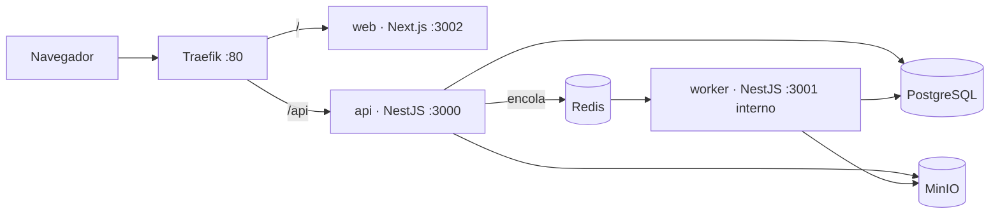
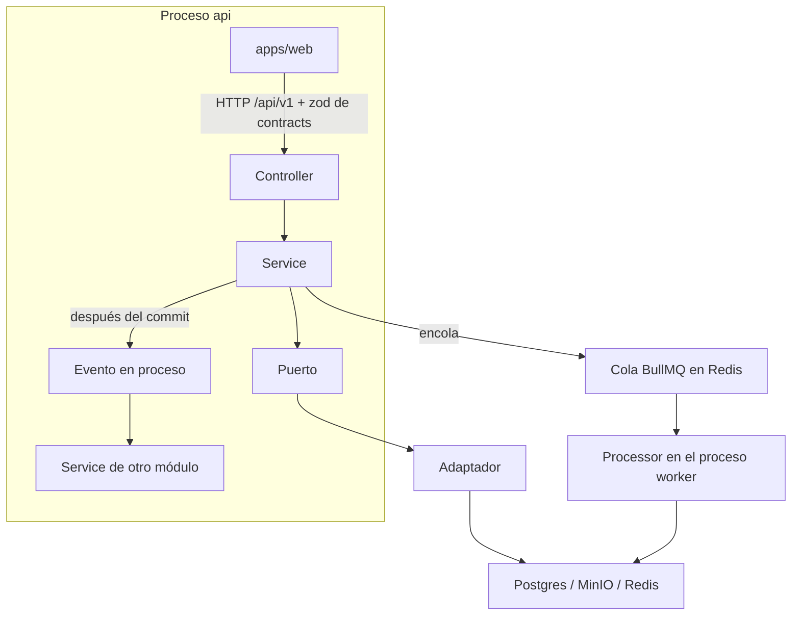
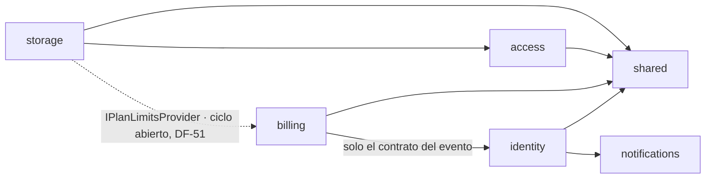
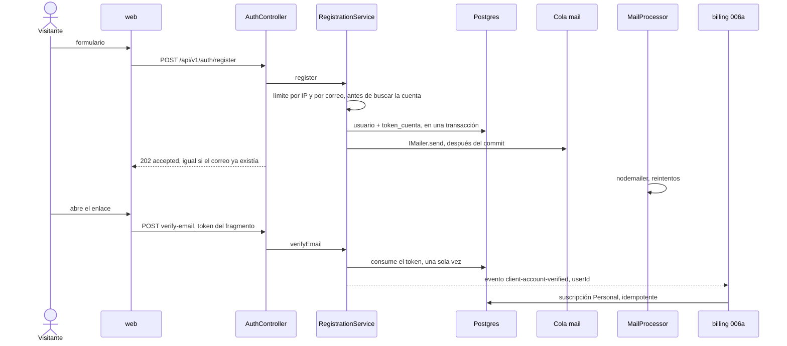
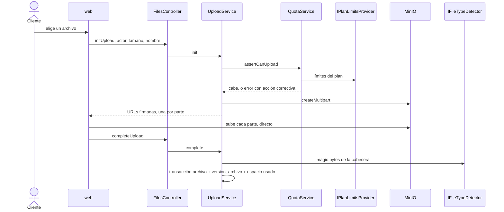

# Cómo funciona Nimbo — guía para la defensa

> Síntesis para explicar el sistema en la exposición. **No sustituye** a las specs, a
> `docs/sdd/architecture.md` ni a los ADR: si algo de aquí discrepa de esos documentos, manda el
> documento de origen.
>
> Fecha de esta síntesis: 29/09/2026. Alcance pedido: specs **000, 000b, 001, 002, 003, 005 y 006a**.

## 1. Cómo leer este documento

Hay tres grados de certeza. En la defensa conviene decir en cuál está cada frase.

| Marca | Significado |
|---|---|
| **En código** | Existe en `main` y se puede mostrar levantando el entorno. |
| **Plan aprobado** | La spec y el `plan.md` están aprobados. El comportamiento está decidido. El código de negocio todavía no está integrado. |
| **Diseño previsto** | Está en la arquitectura, el contexto de producto o un pedido explícito de otra spec. **Aún no hay `spec.md`.** No se implementa hasta que exista (Artículo I). |

| Spec | Qué cubre | Estado al 29/09/2026 |
|---|---|---|
| 000 fundaciones | Monorepo, compose, `shared`, salud, logger, `correlationId`, worker | **En código** (bloques 1 y 2). CI, imágenes y staging quedan para después del 30/09 |
| 000b sistema de diseño | Tokens Cielo Sereno, layout y componentes base | **En código** (en revisión; los PR de la spec ya están en `main`) |
| 001 registro y verificación | Alta de cliente, correo, evento de cuenta verificada | **Plan aprobado** |
| 002 sesiones y dispositivos | Login, refresh, recuperación, sesiones | **Plan aprobado**. Depende de 001 |
| 003 roles y acceso | Guards, `Actor`, `PermissionResolver`, rol de base `nimbo_app` | **Plan aprobado**. Depende de 002 |
| 006a catálogo y límites | Tabla `plan`, suscripción Personal, `IPlanLimitsProvider` | **Diseño previsto**. Sin spec. La usan 001, 005 y 007 |
| 005 carga y descarga | Subir, bajar y validar el tipo real del archivo | **Diseño previsto**. Sin spec. Depende de 003 y de 006a |

Orden real de construcción: **000 → 000b y 006a en paralelo → 001 → 002 → 003 → 005**. 006a puede
empezar en cuanto existan las fundaciones, porque el registro no la espera para funcionar: publica
el evento aunque nadie lo escuche.

---

## 2. Qué es el sistema, en una frase

Nimbo es un **monolito modular**: un solo código de negocio, partido en módulos con fronteras
verificadas, desplegado como **tres procesos** (`web`, `api`, `worker`) que comparten Postgres,
Redis y MinIO.

No son microservicios. Con cuatro personas y un servidor de 8 GB (ONLYOFFICE se queda con unos
4 GB) un servicio por módulo gastaría el tiempo del curso en red, despliegue y contratos, y
además la autorización tiene que resolverse **dentro de una sola consulta SQL**. La decisión está
en ADR-0001.



En local, `docker compose up -d` levanta Postgres (con pgvector), Redis, MinIO, su inicialización
de bucket, Traefik y Mailpit. ONLYOFFICE solo arranca con `--profile onlyoffice`. Las tres apps
corren en el host con `pnpm dev`. Traefik enruta `/` al puerto 3002 y `/api` al 3000
(`infra/traefik/local-routes.yml`).

---

## 3. Conceptos que hay que saber nombrar

Los nombres salen de la leyenda de los diagramas de clases (`docs/sdd/design-model.md` §1). En el
código, el sufijo del archivo dice el estereotipo: `upload.service.ts`, `files.controller.ts`,
`ping.processor.ts`.

### Módulo

Un módulo es una frontera de negocio con dueño, tablas propias y una sola puerta de salida:
`modules/<nombre>/index.ts`. Otro módulo **solo** importa desde ese archivo. El lint
(`packages/config`, ADR-0008) rechaza importar un repositorio, una entidad o una carpeta interna
ajena.

Los de este alcance:

| Módulo | Diagrama | Responsabilidad en este alcance |
|---|---|---|
| `shared` | T1 | Piezas que todos usan: `Actor`, reloj, errores, logger, salud, correlación, y (003) los guards |
| `identity` | M1 | Registro, verificación, login, sesiones, dispositivos |
| `notifications` | T4 | Enviar correo. Declara el puerto `IMailer` y también lo implementa |
| `billing` | M4 | Catálogo de planes y límites. En 006a, la suscripción Personal |
| `access` | M3a | Decidir quién puede hacer qué. Solo lectura |
| `storage` | M2 | Archivos: carga, descarga, tipo real, cuota |

`audit`, `realtime`, `sharing`, `editing`, `intelligence`, `optimizer` y `backoffice` existen como
carpeta vacía (`export {}`) para que el grafo ya tenga nombre. No participan en estos flujos.

### Capas dentro de un módulo

```
modules/<modulo>/
├─ domain/           reglas e invariantes. Sin Nest ni TypeORM
├─ application/      servicios que orquestan casos de uso, y los puertos que necesitan
├─ infrastructure/   TypeORM, Redis, MinIO, SMTP, colas: el mundo exterior
├─ presentation/     controladores HTTP. Validan, mapean y delegan
├─ <modulo>.module.ts
└─ index.ts          lo único que el resto del sistema puede importar
```

`domain` no importa frameworks. `application` no importa `infrastructure` ni `presentation`:
depende de **puertos**. El lint de capas (spec 000, CA-6) lo hace cumplir.

### Service

Un **service** (estereotipo azul del diagrama) es un servicio de **aplicación**. Orquesta un caso
de uso: llama al dominio, a los puertos y, cuando escribe en más de una tabla, a una transacción.

Ejemplos de este alcance:

| Servicio | Módulo | Qué decide |
|---|---|---|
| `RegistrationService` | identity | Alta, reenvío y verificación de correo |
| `AuthService` | identity | Credenciales y bloqueo por intentos |
| `SessionService` | identity | Abrir, rotar, listar y revocar sesiones |
| `PasswordService` | identity | Recuperar y cambiar la contraseña |
| `PermissionResolver` | access | Si un actor puede una acción sobre un nodo |
| `UploadService` | storage | Iniciar, completar o rechazar una carga |
| `QuotaService` | storage | Si el archivo cabe en el plan, **antes** de subir |
| `HealthService` | shared | Si Postgres, Redis y MinIO responden (**en código**) |
| `PlanCatalogService` | billing | Leer el catálogo (006a; el nombre viene del diagrama) |

Regla de la constitución (DF-01, spec 003): si el servicio toca datos de un usuario, el primer
parámetro es `actor: Actor`. El filtro de «¿esto es mío?» ocurre **dentro de la consulta**, no
después de traer filas y descartarlas en memoria.

Un service no habla HTTP, no conoce Express y no abre sockets a MinIO por su cuenta. Eso es trabajo
del controlador o del adaptador.

### Controller

Un **controller** es la capa HTTP. Recibe la petición, valida el cuerpo con un esquema zod de
`packages/contracts` (`ZodValidationPipe`, ADR-0020) y llama a un service. No contiene reglas de
negocio.

En este alcance: `HealthController` (**en código**), `AuthController`, `PasswordController`,
`SessionsController` (identity) y `FilesController` (storage, diseño previsto).

### Puerto y adaptador

Un **puerto** es una interfaz pequeña (`IMailer`, `IObjectStorage`, `IPlanLimitsProvider`). La
aplicación depende del puerto. La infraestructura aporta el **adaptador** (`SmtpMailer`,
`MinioStorageAdapter`). Cambiar MinIO por otro almacén S3 no toca `UploadService`.

Quién declara el puerto y quién lo implementa no siempre es el mismo módulo. `notifications`
declara **e** implementa `IMailer`; `identity` solo lo consume. `shared` declara
`IAccessTokenVerifier`; `identity` lo implementa. Así `shared` nunca importa `identity`, y el grafo
sigue siendo un DAG (sin ciclos).

### Contrato

`packages/contracts` es el paquete que comparten `web` y `api`: esquemas zod, códigos de error y
tipos de respuesta. El formulario de registro y el `ZodValidationPipe` usan **el mismo** esquema.
Un mensaje de error al usuario sale de un catálogo por `code`, en español y con una acción
correctiva (`{ code, message, correlationId }`). El stack nunca llega al navegador.

### Actor

```ts
interface Actor {
  readonly id: string;
  readonly role: Role;             // CLIENT | ADMIN | SUPPORT | OPERATOR
  readonly canReadContent: boolean; // true solo para CLIENT
}
```

El tipo ya está en código (`apps/api/src/shared/domain/actor.ts`). Quien lo **construye** a partir
del token es el guard de la spec 003, en un solo lugar (`createActor`). Nadie lee `req.user`.
Ningún rol interno tiene `canReadContent: true`: Administrador, Soporte y Operador no ven
contenido ni vistas previas. No existe la suplantación.

### Guard

Un guard corre **antes** del controlador y puede rechazar la petición.

- `JwtAuthGuard` (003): exige `Authorization: Bearer` válido, salvo que la ruta lleve `@Public()`.
- `RolesGuard` (003): exige `@Roles(...)`. Sin ese decorador, la ruta responde 403. Negación por
  defecto.
- `IdentityIpThrottlerGuard` (001/002): límite de tasa por IP en registro y login.

401 y 403 salen por el mismo `DomainExceptionFilter` que el resto de errores de dominio, con
códigos estables `SHARED_UNAUTHENTICATED` y `SHARED_FORBIDDEN`.

### Worker, cola, processor y job

Son cuatro cosas distintas. Conviene no usarlas como sinónimos.

| Concepto | Qué es | Dónde vive |
|---|---|---|
| **Worker** | Un **proceso** Node aparte, con su propia imagen (`nimbo-worker`) y su propio puerto de salud (`WORKER_PORT`, 3001). Ese puerto no se publica en Traefik | `apps/api/src/worker.main.ts` + `WorkerModule`. `apps/worker` solo compone: importa el código de `api` |
| **Cola** | Una lista durable en **Redis**, gestionada por BullMQ. La API empuja un trabajo y sigue. El worker lo toma cuando puede | Redis |
| **Processor** | La clase que **consume** una cola (`*.processor.ts`). Corre solo dentro del proceso worker | Infraestructura del módulo dueño. Hoy: `PingProcessor` |
| **Job** | Una tarea **programada** con reloj (`*.job.ts`, `@Cron`), también en el worker. No la dispara una petición | Aún no hay ninguna. La primera de negocio será `RenewalScheduler`, fuera de este alcance (spec 010) |

Por qué existe el worker (ADR-0001): indexar, optimizar un PDF o entregar correo no puede tumbar
las peticiones HTTP. Si el SMTP cae, el registro **responde igual** y el worker reintenta. Si el
worker se reinicia, la API sigue sirviendo salud, login y descargas.

Hoy la única cola real es `ping`: la API puede encolarla y `PingProcessor` escribe `job.started` /
`job.completed` con el mismo `correlationId` de quien la encoló. Es el molde de todas las colas
siguientes. La primera de negocio es `mail` (spec 001, ADR-0018).

La salud del worker solo mira Redis (sin Redis no hay colas). La de la API mira Postgres, Redis y
MinIO. `GET /api/v1/health/live` dice «el proceso respira» y no consulta dependencias.
`GET /api/v1/health/ready` dice «puede atender» y responde 503 si alguna dependencia está caída.

### Evento de dominio

Un evento es un aviso **dentro del proceso `api`**, después de que la transacción ya hizo commit
(`@nestjs/event-emitter`, ADR-0019). El productor no conoce al consumidor.

El primero de este alcance:

| | |
|---|---|
| Nombre | `identity.client-account-verified` |
| Forma | `{ userId: string }` — sin correo ni nombre |
| Quién publica | `RegistrationService.verifyEmail`, una sola vez por cuenta |
| Quién escucha | `billing` (006a): crea la suscripción Personal |
| Si nadie escucha | La cuenta queda verificada igual |

El contrato (el nombre y el tipo) se exporta en `identity/index.ts`. `billing` puede importar
**solo eso**, nunca un servicio ni una entidad de identidad. El oyente tiene que ser idempotente
(llamado dos veces, una sola suscripción) y 006a además reconcilia las cuentas verificadas que se
hayan quedado sin plan, por si el proceso cae entre el commit y la emisión.

Esto no es una cola. El evento es síncrono y en memoria: por eso el `correlationId` llega al
oyente sin trabajo extra. El correo, en cambio, **sí** va a una cola, porque SMTP es lento y puede
fallar.

### correlationId

Cada petición HTTP recibe un UUID (`x-correlation-id`; si el cliente manda uno válido, se reutiliza).
Viaja en un `AsyncLocalStorage` (`CorrelationContext`) y el logger lo pone en cada línea. Cuando la
API encola un trabajo, el id va dentro del payload (`enqueueWithCorrelation`) y el processor abre
de nuevo el contexto. Así, en la defensa, se puede seguir una sola operación desde el navegador
hasta el correo, sin meter en la bitácora contraseñas, tokens, nombres de archivo ni contenido.

---

## 4. Cómo se comunica una pieza con otra

Hay cuatro mecanismos, y cada uno tiene un motivo. Mezclarlos es el error típico.



1. **HTTP + contratos**, de `web` hacia `api`. El navegador no habla con Postgres, Redis, MinIO ni
   con el worker. La clave del modelo de lenguaje, cuando exista, tampoco llega al navegador.
2. **Import del `index.ts`**, entre módulos del mismo proceso. Es una llamada de función normal
   (un service pide `IMailer`). El lint impide saltarse la puerta.
3. **Evento en proceso**, cuando el productor no debe depender del consumidor. Identidad no sabe
   qué es un plan; facturación sí sabe que una cuenta quedó verificada.
4. **Cola**, cuando el trabajo puede esperar, reintentarse o tumbar el proceso si se hace en la
   petición. Correo, y más adelante indexación, guardado de ONLYOFFICE y optimización.

Reglas que sostienen el grafo (arquitectura §3):

- El grafo es un DAG. Si dos módulos se necesitan, uno define un puerto y el otro lo implementa
  **sin importar al primero**, o se usa un evento.
- `access` es la única excepción documentada a «cada módulo es dueño de sus tablas»: lee por SQL
  de solo lectura las tablas de archivos y, desde la spec 012, las de comparticiones. La
  autorización tiene que resolverse dentro de la consulta (ADR-0005, ADR-0010).
- Los transversales (`notifications`, y más adelante `audit` y `realtime`) no dependen de un
  módulo de negocio.

Dependencias de **este** alcance:



La flecha punteada es un problema conocido: `storage` necesita los límites del plan y `billing`
necesita, más adelante, guardar facturas en MinIO. Ese ciclo (**DF-51**) se cierra en el plan de
006a, antes de escribir código de facturación. Hasta entonces no se inventa un atajo.

---

## 5. Lo que ya corre: spec 000

**En código.** Cualquier integrante clona, copia `.env.example`, levanta compose, corre las
migraciones y `pnpm dev`.

Qué hace cada arranque:

1. Carga el `.env` de la raíz y lo valida con zod (`apiEnvSchema` o `workerEnvSchema`). Si falta
   una variable, escribe `config.invalid` en stderr y sale con código 1. No hay modo «arranca a
   medias».
2. `synchronize` de TypeORM está fijo en `false`. El esquema solo cambia con una migración
   versionada y con `down`. Hoy todavía no hay tablas de negocio: el esqueleto deja la fuente de
   datos lista.
3. La API registra `SharedModule`, la salud (Postgres, Redis, MinIO) y la cola `ping`.
4. El worker registra `SharedModule`, la salud (solo Redis) y el `PingProcessor`. Al arrancar
   escribe `worker.started` con `correlationId` y la lista de colas.
5. Toda respuesta de error de dominio pasa por `DomainExceptionFilter`. Toda línea de log pasa por
   Pino y por una lista de campos redactados (contraseñas, tokens, correos cuando el plan de 001
   los agregue).

La página de `web` pregunta a la API su salud y muestra «API: disponible» o el texto de fallo, más
el ambiente y la versión. No cachea ese estado en el build (`force-dynamic`).

Lo que 000 **deja preparado** y todavía no está en `main`: el workflow de GitHub Actions, las
imágenes en `ghcr.io/afmatul/nimbo-{api,worker,web}` y el Droplet de staging (`staging.nimbo.me`,
`api.staging.nimbo.me`). Es el mismo `compose.yml`; cambian el override (local) y
`compose.staging.yml` (imágenes por SHA, TLS, sin puertos internos).

---

## 6. Lo que ya se ve: spec 000b

**En código.** 000b no tiene casos de uso de negocio. Deja la única fuente visual para que 001,
002, 003 y 005 no inventen colores.

- Los tokens viven solo en `apps/web/src/app/globals.css` (Tailwind v4 + shadcn). Un componente no
  escribe hex ni `bg-[#…]`.
- La familia es Inter, cargada con `next/font`. Cifras tabulares para tamaños y precios. No hay
  fuente monoespaciada.
- El contraste está corregido respecto al mockup original (DF-41 a DF-45): el botón primario es
  `#4A6FA5` sobre blanco, no el azul decorativo `#6B8DD6`, que se reserva para ilustraciones sin
  texto encima. El contraste AA manda sobre el mockup.
- `AppLayout` es el cascarón (encabezado, barra lateral que en 360 px se vuelve menú).
- `Button`, `Input`, `Card`, `Badge`, `FileTypeChip`, `CitationChip` y `StateView` (`empty`,
  `loading`, `error` con botón «Reintentar») son los ladrillos. `StateView` es el que van a usar
  el registro, la seguridad y el explorador cuando una operación tarda o falla.
- `jest-axe` exige cero violaciones WCAG 2.1 AA. El color nunca es el único canal: un chip de tipo
  de archivo lleva texto, no solo un color.

`apps/web` no importa `docs/design/mockups/`. Los mockups son referencia; el lint falla si alguien
los arrastra al build.

---

## 7. Recorrido de una cuenta nueva: spec 001

**Plan aprobado.** Módulos: `identity`, `notifications`, cambios en `shared`, pantallas en `web`.

### Qué ve la persona

1. Entra a registrarse. La pantalla pide nombre, correo, contraseña y la aceptación de Términos y
   Privacidad (se guardan la versión y la fecha).
2. Al lado ve el catálogo de planes, leído de la API de 006a. Si esa API no responde, la pantalla
   entra en `catalogo-no-disponible` y el alta **sigue**: la cuenta siempre nace en Personal.
   Elegir Pro o Equipo no cobra nada aquí; contratar es la spec 009 (Fase 2).
3. Al enviar, la API responde enseguida. El enlace llega por correo (en local, Mailpit).
4. Abre el enlace. El token viaja en el **fragmento** de la URL (`#token=`). El fragmento no sale
   del navegador: no queda en logs de Traefik ni en el header `Referer`.
5. La cuenta pasa a verificada. Si 006a ya escucha, nace la suscripción Personal.

### Qué hace el servidor



Piezas que hay que poder señalar:

- **Dominio.** `ClientUser`, `VerificationToken`, `EmailAddress`, `OpaqueToken`. El token opaco es
  de 256 bits; en la base se guarda su SHA-256, nunca el valor que viajó por correo. Un solo token
  vigente por cuenta. Consumirlo es un `UPDATE … WHERE usado_en IS NULL`: dos clics a la vez no
  verifican dos veces.
- **Aplicación.** `RegistrationService` orquesta. `VerificationLinkIssuer` invalida el enlace
  anterior y emite otro (el reenvío y, en 002, la recuperación lo reutilizan).
  `RegistrationAttemptNotifier` avisa si alguien intenta registrar un correo que ya existe, sin
  decirle al visitante si ese correo está tomado (anti-enumeración).
- **Puertos.** `IPasswordHasher` → `Argon2idHasher`. `IMailer` → `SmtpMailer`, que **no** habla
  SMTP: encola en `mail`. `IRateLimiter` → `RedisRateLimiter` (límite por correo). `IClock` para
  que las pruebas no usen `Date.now()` ni `sleep`. `IAccountEventsPublisher` aísla el mecanismo de
  eventos. `ITransactionRunner` agrupa las escrituras.
- **Worker.** `MailProcessor` + `SmtpTransport` (nodemailer). Cinco reintentos, backoff
  exponencial desde 5 s. Idempotencia: el `jobId` es la clave que puso el productor, más una marca
  en Redis `mail:sent:<jobId>`, más un `Message-ID` determinista. Un reintento no manda dos
  correos distintos.
- **Presentación.** Tres rutas públicas: `register`, `verify-email`, `resend-verification`. El
  límite por IP es `@nestjs/throttler`, distinto del límite por correo.

Tablas: `usuario` (rol con `CHECK`, sin tabla `rol`; `correo_verificado`; versiones de Términos y
Privacidad) y `token_cuenta`.

Si el SMTP está caído, el `POST` de registro ya respondió. El worker reintenta. Un SMTP caído no
marca al worker como enfermo: su salud sigue siendo Redis.

---

## 8. Entrar, salir y reconocer el dispositivo: spec 002

**Plan aprobado.** Sigue todo dentro de `identity`. El worker no cambia: los correos nuevos son
otras plantillas que salen por el mismo `IMailer`.

### Las dos credenciales

| | Access token | Refresh token |
|---|---|---|
| Qué es | JWT HS256, 15 minutos | Opaco, `<sid>.<secreto>` |
| Dónde vive | Solo en memoria del navegador | Cookie `httpOnly`, `SameSite=Strict`, acotada a `/api/v1/auth/session` |
| Qué lleva | `sub`, `rol`, `sid`, `iat`, `exp`. Nada de correo ni de nombre | El secreto. En `sesion` se guarda el hash del vigente y el hash del anterior |
| Quién lo fabrica | `JwtTokenService` (`ITokenService`) | `SessionService` |

El navegador manda el access token en `Authorization: Bearer`. A los 15 minutos, `web` llama a
`session/refresh` y la cookie viaja sola. Rotar es transaccional (`FOR UPDATE` sobre la fila): el
token viejo sirve unos 10 segundos de gracia; presentarlo después **revoca** la sesión. Así un
token robado y el token legítimo no conviven.

El dispositivo es otro identificador aleatorio de 256 bits, en otra cookie `httpOnly` de un año,
guardado como hash en `dispositivo`. Si el login llega desde un dispositivo que esa cuenta no
tenía, se abre la sesión igual y se encola un correo de aviso. No es un segundo factor: TOTP está
fuera de alcance.

### Servicios y rutas

- `AuthService`: login y bloqueo por correo (`IAttemptLockout` → Redis, reloj de `IClock`).
- `SessionService`: abrir, rotar, listar, revocar. Listar y revocar reciben `actor` y filtran
  `usuario_id = actor.id` en la consulta.
- `PasswordService`: recuperación (token de un uso, el mismo mecanismo de 001; al usarlo se
  invalidan las sesiones) y cambio de contraseña.
- `AuthController`: login, refresh, logout. La verificación de 001, al tener éxito, también abre
  sesión.
- `PasswordController` y `SessionsController`: separados de `AuthController` para que cada clase
  cambie por una sola razón.

`JwtTokenService` implementa el puerto `IAccessTokenVerifier`, que **declara** `shared` en la spec
003. La estrategia de Passport solo delega en ese puerto. `shared` y el futuro tiempo real
verifican tokens sin importar `identity`.

Pantallas: iniciar sesión, recuperar, restablecer, menú de cuenta y «Seguridad» (sesiones y
dispositivos, para los cuatro roles). El grupo de rutas con sesión (`SessionProvider`,
`SessionGate`) es el que 003 parte en área de cliente y área interna.

---

## 9. Quién puede hacer qué: spec 003

**Plan aprobado.** Casi todo cae en `shared` y en el módulo nuevo `access`. No crea tablas de
negocio.

### Primera barrera: la petición

Desde el PR-A de esta spec, `AppModule` carga `AuthGuardsModule` y **niega por defecto**:

1. Sin `@Public()`, hace falta un Bearer válido. El guard llama a `IAccessTokenVerifier`. Si 002
   todavía no registró la estrategia, toda ruta no pública responde 401.
2. `handleRequest` arma el `Actor` (`canReadContent` solo si el rol es `CLIENT`) y lo guarda en un
   `WeakMap` de la petición.
3. `@CurrentActor()` se lo entrega al controlador. El controlador se lo pasa al service.
4. Sin `@Roles(...)`, `RolesGuard` responde 403. Una ruta nueva no queda «abierta por olvido».

Las rutas de salud y las de registro/login llevan `@Public()`. Ocultar un botón en la UI es
cortesía, no seguridad: la matriz se aplica en el servidor.

### Segunda barrera: la fila

ADR-0005. Aunque un service olvide el `WHERE`, la base no devuelve filas ajenas.

- Las migraciones usan `DATABASE_MIGRATION_URL` (rol dueño).
- `api` y `worker` se conectan como `nimbo_app`: puede entrar, no es superusuario, no tiene
  `BYPASSRLS`, no es dueño de las tablas. Al arrancar, `DatabaseRoleCheck` se niega a correr si la
  conexión es demasiado poderosa.
- `withActor(actor, trabajo)` abre la transacción, ejecuta
  `set_config('app.actor_id', …, true)` y `set_config('app.actor_role', …, true)` (equivalente a
  `SET LOCAL`, con parámetros, no concatenando SQL) y publica el actor en el mismo contexto que
  ya usa `ITransactionRunner`. Una regla de lint prohíbe `set_config` en cualquier otro archivo.
- 003 deja las funciones SQL `nimbo_actor_id()` y `nimbo_actor_role()`. Las políticas RLS de
  `archivo` y `version_archivo` las escribe **005**. Sin actor, cero filas.

### Módulo access

`PermissionResolver.can(actor, nodeId, action)` responde si **esta** acción está permitida sobre
**este** nodo. Las reglas son estrategias: `OwnerPolicy`, `EditorPolicy`, `ViewerPolicy`. Un nivel
nuevo es una clase nueva, no un `if` más. Los roles internos ni siquiera consultan: no hay
contenido para ellos.

`accessibleNodes(actor)` es el fragmento SQL único que van a usar listados, búsqueda, descarga,
vista previa, edición y el agente. En 003 devuelve el conjunto vacío, tipado, porque aún no hay
tablas de archivos. 005 le agrega «lo que esta cuenta posee». 012 le agrega lo compartido y lo
heredado por la ruta de la carpeta.

La suite `pnpm test:isolation` arma dos clientes con datos casi idénticos y una cuenta por rol
interno, y corre con los dos roles reales de Postgres. Una fuga rompe la verificación. Hoy el
arnés existe como script marcador; el «mundo» con cuentas lo construye 003.

En `web`, `homePathFor(role)` manda al cliente a su área y al rol interno a un marcador. «Sin
permiso» y «no encontrado» reutilizan los estados de 000b. Un 404 no confirma que el archivo
existe en otra cuenta.

---

## 10. Planes y límites: spec 006a

**Diseño previsto. No hay spec.** Dueña: Fátima. Lo que ya está decidido, y que la defensa puede
sostener porque lo escribieron 001, el contexto de producto y el diagrama, es esto:

- Los cuatro planes (Personal, Pro, Equipo, Institucional), con precio en **centavos** y tamaños
  en **bytes**, viven en la tabla `plan`. Una migración los siembra. Ni `web` ni `identity` ni
  `storage` escriben «15 GB» o «Q45.00» en código.
- El valor que el resto consulta es `PlanLimits`, detrás del puerto `IPlanLimitsProvider`
  (almacenamiento, máximo por archivo, editores simultáneos, consultas al agente, versiones,
  retención de papelera). `storage` no recibe el `SubscriptionService` entero: solo los límites
  que necesita (segregación de interfaces).
- Lectura **pública** del catálogo activo: `id`, nombre, precio en centavos y una marca de plan
  gratuito. La pantalla de registro de 001 la consume. Si no está, 001 degrada a
  `catalogo-no-disponible` (pedido **PD-40**).
- Oyente idempotente de `identity.client-account-verified`: crea la suscripción Personal.
- Conciliación: toda cuenta `CLIENT` verificada sin suscripción recibe Personal, para las cuentas
  que se verificaron antes de que el oyente existiera.
- Pagos, facturas, cambio de plan y solo lectura por vencimiento **no** son 006a. Son 008, 009 y
  010.

Al explicar 006a hay que decir en voz alta que el ciclo `storage ↔ billing` (DF-51) sigue abierto
y que el plan de la spec es el lugar donde se cierra, no un import cruzado «mientras tanto».

---

## 11. Subir y bajar un archivo: spec 005

**Diseño previsto. No hay spec.** Dueño: Abel. Depende de que 003 ya niegue por defecto y de que
006a ya responda límites. El recorrido de abajo es el de la arquitectura §7.1 y los requisitos
RF-08, RF-09, RF-14, RNF-06 y RNF-07. La spec, cuando exista, puede precisar rutas y nombres; la
defensa no debe presentar este apartado como código ya escrito.

### Carga

El navegador no hace `POST` del archivo contra la API. La API autoriza y MinIO recibe los bytes,
por URLs firmadas, a través de Traefik (`/s3` en local; `s3.staging.nimbo.me` en staging). Así un
archivo de hasta 2 GB no atraviesa el proceso Node.



Qué se defiende de este flujo:

- **`QuotaService` antes de la primera parte.** Si no cabe, la persona recibe un mensaje que dice
  qué hacer (bajar algo, o más adelante cambiar de plan). No se suben 2 GB para rechazarlos al
  final.
- **Tipo real por contenido** (`MagicBytesDetector`), no por la extensión. Un `.exe` renombrado a
  `.pdf` se rechaza: se borra el objeto y la carga queda `rechazada` con motivo.
- **Origen aislado y descarga forzada** (RNF-07). El archivo no se sirve desde el mismo origen de
  la aplicación como una página. La URL de descarga dura 5 minutos y apunta a un objeto; los id
  no son correlativos (RNF-06).
- **`accessibleNodes` dentro del SQL** del listado y de la descarga. 005 agrega la propiedad
  («este cliente es dueño»). Dos clientes con archivos del mismo nombre no se ven.
- **RLS encendida y forzada** en `archivo` y `version_archivo`. `CLIENT` ve sus filas.
  `ADMIN` y `SUPPORT` pueden ver metadatos de `archivo` y **ninguna** fila de `version_archivo`
  (ahí está la clave del objeto en MinIO). `OPERATOR` no ve filas. Sin actor, cero filas. Quitar
  el `WHERE` en una prueba de aislamiento no abre la puerta: la política sigue negando.
- El worker, en un trabajo sobre un archivo, actúa como el dueño que viene en el payload, con el
  mismo `nimbo_app`. Los trabajos de mantenimiento sin actor (purga de papelera) son el hallazgo
  **DF-52**, que el plan de 005 tiene que decidir. La papelera en sí es la spec 006, no esta.

Carpetas, papelera, versiones restaurables, vista previa y el medidor de espacio son 006, 007,
014 y 017. 005 deja el archivo guardado, tipado y descargable.

---

## 12. El sistema de punta a punta, cuando estas specs estén integradas

Este es el relato único. Cada paso cita quién lo posee. Los pasos 1–2 se pueden demostrar hoy; del
3 en adelante están diseñados.

1. **La persona abre `http://localhost`.** Traefik entrega `web`. La página (000b sobre el layout
   de 000) consulta `/api/v1/health/ready`. La API pregunta a Postgres, Redis y MinIO y responde
   con `correlationId`.
2. **Elige un plan y se registra (001 + 006a).** `web` lee el catálogo público. `RegistrationService`
   persiste `usuario` y `token_cuenta`, encola el correo y responde `202` con el mismo cuerpo tanto
   si el correo es nuevo como si ya existía. `MailProcessor`, en el otro proceso, entrega el mensaje
   a Mailpit. Si Redis está caído, el límite por correo falla cerrado (500) antes de crear la cuenta.
   El SMTP puede estar caído sin impedir ese `202`: el worker reintenta.
3. **Abre el enlace (001).** El fragmento nunca viajó al servidor de correo ni a Traefik. La API
   consume el token, marca el correo verificado y publica el evento. `billing` crea la suscripción
   Personal.
4. **Inicia sesión (002).** Argon2id verifica la contraseña. Nacen el JWT de 15 minutos (memoria) y
   la cookie de refresco. Si el dispositivo es nuevo, otro trabajo `mail` avisa.
5. **Cada clic posterior (003).** `JwtAuthGuard` reconstruye el `Actor`. `RolesGuard` mira
   `@Roles`. El service recibe ese actor y abre `withActor`, así la transacción y la política RLS
   ven a la misma persona.
6. **Sube un archivo (005 + 006a).** `QuotaService` pregunta `IPlanLimitsProvider`. Si el Personal
   da 15 GB y 50 MB por archivo, un archivo de 80 MB se rechaza antes de tocar MinIO. Si cabe, el
   navegador sube las partes a MinIO, la API comprueba los magic bytes y cierra la transacción.
7. **Lo descarga (005 + 003).** La consulta de descarga incluye `accessibleNodes`. La API devuelve
   una URL firmada de 5 minutos. Otro cliente, un administrador o una petición sin token no
   obtienen esa clave. La UI puede esconder el botón; la garantía está en el SQL y en RLS.

En ningún paso el navegador habla con el worker. En ningún paso `identity` importa `billing`. En
ningún paso la bitácora lleva la contraseña, el token o el nombre del archivo.

---

## 13. Decisiones que conviene poder defender en una pregunta

| Pregunta probable | Respuesta corta | Dónde está |
|---|---|---|
| ¿Por qué no microservicios? | Cuatro personas, un servidor chico, y la autorización es una sola consulta SQL | ADR-0001 |
| ¿Por qué un worker separado y no colas dentro de la API? | Un archivo grande o un SMTP colgado no deben tumbar el HTTP. Separarlo al final obligaría a reescribir correlación y salud | ADR-0001 |
| ¿Por qué el worker no es otro repositorio? | Mismo dominio y mismos puertos. `apps/worker` solo compone módulos de `api`. Dos imágenes, un solo código | ADR-0001, plan 000 |
| ¿Por qué Nest y TypeORM con migraciones a mano? | El equipo ya modeló en clases; `synchronize: true` no es reversible ni revisable | ADR-0002, spec 000 D-14 |
| ¿Por qué Argon2id y JWT corto más refresh opaco? | El hash aguanta hardware dedicado (RNF-04). El JWT no se guarda en `localStorage`. Robar uno no alcanza para renovar | ADR-0017, plan 002 |
| ¿Por qué el correo va a una cola? | El registro no puede depender de que SMTP responda. Reintento e idempotencia viven en el worker | ADR-0018 |
| ¿Por qué un evento y no una llamada de identity a billing? | Identidad no debe conocer planes. El alta funciona aunque 006a no exista | ADR-0019, plan 001 |
| ¿Por qué guards en `shared` y no en administración? | Toda ruta queda negada por defecto, también las que aún no escribe backoffice | Spec 003 D-2, ADR-0010 |
| ¿Por qué RLS además del `WHERE`? | Segunda barrera. Un olvido en un repositorio no entrega filas de otra cuenta | ADR-0005 |
| ¿Por qué los colores no son los del mockup original? | Esos tonos no pasaban WCAG AA. El contraste manda | ADR-0014, spec 000b |
| ¿Por qué zod en `contracts` y no class-validator? | Un solo esquema para el formulario y para la API | ADR-0020 |

---

## 14. Qué no afirmar en la exposición

- Que 001, 002 o 003 ya están implementadas. Están especificadas y planificadas. El código de
  `main` tiene el esqueleto (`identity/index.ts` exporta vacío) y las piezas de `shared` de la
  spec 000.
- Que 005 o 006a tienen spec. No la tienen. El apartado 10 y el 11 describen el diseño ya escrito
  en arquitectura, producto y pedidos de 001/003. La spec, cuando se redacte, es la fuente de
  verdad.
- Que el CI despliega staging. Ese bloque de 000 empieza a partir del 30/09.
- Que Soporte puede «entrar a la cuenta del cliente». No puede. Ve metadatos y estados; restaurar
  la papelera ajena, con motivo y auditoría, es la spec 011.
- Que ya hay carpetas, papelera, compartición, pagos, ONLYOFFICE, agente u optimizador. Están en
  el mapa (006 en adelante) y fuera de este relato, salvo como contexto de por qué el worker y los
  puertos existen.
- Que `accessibleNodes` ya filtra archivos. En 003 el conjunto está vacío a propósito. El filtro de
  propiedad llega con 005.

Pendientes que un docente puede haber leído y que conviene reconocer: **DF-51** (ciclo
storage/billing, se cierra al planear 006a), **DF-52** (trabajos del worker sin actor, se cierra
al planear 005) y **PD-40** (los tres pedidos concretos de 001 hacia 006a: catálogo público,
oyente idempotente y conciliación).
