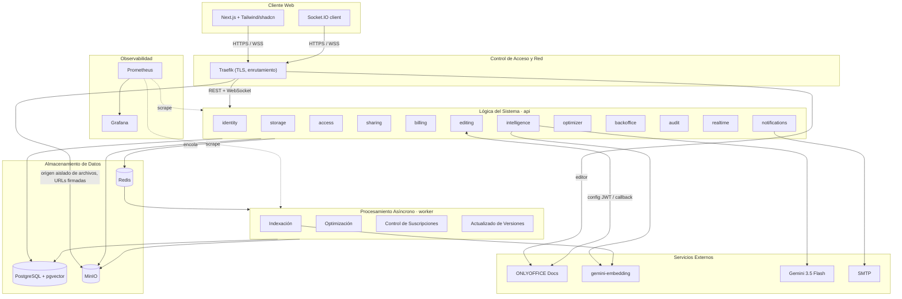

# Arquitectura de Nimbo

> Guardián: subagente `architect`. Todo cambio va con un ADR y con la actualización de los diagramas en `docs/design/diagramas/`.
> Nombres de clases: `docs/sdd/design-model.md`. Problemas conocidos del diseño: `docs/sdd/design-findings.md` (DF-xx).

## 1. Estilo: monolito modular con procesamiento asíncrono

El diagrama de arquitectura define cinco capas: **Cliente Web → Control de Acceso y Red → Lógica del Sistema →
Procesamiento Asíncrono → Almacenamiento de Datos**, más **Servicios Externos**. Se despliega como:

- `web`: Next.js.
- `api`: NestJS con los módulos de la «Lógica del Sistema» (REST + WebSocket).
- `worker`: NestJS standalone con los procesadores y trabajos programados del «Procesamiento Asíncrono» (Indexación,
  Optimización, Control de Suscripciones, Actualizado de Versiones). Usa los mismos módulos que `api`.

Justificación (ADR-0001): 4 personas y 10 semanas no justifican microservicios; las fronteras por módulo permiten
separar uno como servicio el día que haga falta.

**Hospedaje y dominio** (spec 000, D-3 a D-6): DigitalOcean con crédito del GitHub Student Pack. Un Droplet de
**staging** (2 vCPU / 4 GB, Ubuntu LTS + Docker Compose) desde el inicio de la Fase 2 (`workflow.md` §7.2) y un Droplet de **producción** separado
(4 vCPU / 8 GB) en la Fase 4. Dominio `nimbo.me`; en staging Traefik enruta por host con TLS de Let's Encrypt:
`staging.nimbo.me` (web), `api.staging.nimbo.me` (api), `docs.staging.nimbo.me` (ONLYOFFICE, solo con el perfil
activo) y `s3.staging.nimbo.me` (MinIO, habilitado cuando 005 lo necesite). Imágenes en `ghcr.io/afmatul/nimbo-{api,worker,web}`;
despliegue por SSH desde GitHub Actions (`migration:run` antes de `up -d`); rollback = redesplegar la etiqueta anterior.
Solo Traefik publica puertos (80/443). La separación `api`/`worker` es por **proceso e imagen**, no por carpeta (ADR-0001).



Diferencias con el diagrama entregado: ver **DF-28** (flecha Pino→Gemini, embedding de consultas, módulos faltantes,
SMTP, observabilidad, rutas vía Traefik y worker separado).

## 2. Estructura del monorepo

```
nimbo/
├─ compose.yml  compose.override.yml  compose.staging.yml   # en la raíz: `docker compose up -d` sin COMPOSE_FILE
├─ apps/
│  ├─ web/                 # Next.js (App Router)
│  ├─ api/                 # NestJS HTTP + WebSocket
│  │  └─ src/shared/       # módulo transversal T1 (ver §3)
│  │  └─ src/modules/<modulo>/   # aquí viven también los *.processor.ts y *.job.ts de cada módulo
│  └─ worker/              # composición: WorkerModule + main.ts + salud interna; importa `@nimbo/api/*` (solo index.ts)
├─ packages/
│  ├─ contracts/           # DTOs y tipos compartidos web ↔ api (fuente única)
│  └─ config/              # eslint (incl. boundaries.js), tsconfig, jest base
├─ infra/                  # solo configuraciones: traefik/, minio/, deploy/, (022) prometheus/, grafana/, respaldos
├─ docs/operations/        # despliegue, ambientes, rollback (insumo del Manual Técnico)
├─ e2e/  load/  specs/  docs/
```

Los archivos de compose viven en la **raíz** (no en `infra/`) para que los comandos de CLAUDE.md funcionen sin
`COMPOSE_FILE`; `infra/` guarda únicamente configuración de servicios. `worker` importa los módulos de `api` (mismo
código de dominio y aplicación); los procesadores y trabajos viven dentro de cada módulo, el worker solo los compone.
No hay paquete `domain` aparte salvo que un ADR lo justifique.

## 3. Módulos y dependencias

| Módulo | Diagrama | Responsabilidad | Puede depender de |
|---|---|---|---|
| `shared` | T1 (DF-49) | `Actor`, `IClock`, `DomainError` + `DomainExceptionFilter`, logger Pino con redacción, `correlationId`, validación de entorno, `DataSource`, salud (`HealthModule`, `IHealthIndicator`, indicadores Postgres/Redis/MinIO), paginación | — |
| `audit` | M8 (extraído) | `AuditService`, `AuditEntry`; implementa `IAuditLogger` | shared |
| `notifications` | — | Correo y notificaciones; implementa `IMailer` e `INotifier` | shared, realtime |
| `realtime` | M5 (generalizado) | Gateway Socket.IO, salas por usuario y documento | shared, identity (validar token) |
| `identity` | M1 | Registro, verificación, login, refresh, sesiones, dispositivos | shared, notifications, audit |
| `billing` | M4 | Planes, suscripciones, pagos, facturas, renovación; implementa `IPlanLimitsProvider` e `IAgentQuota` | shared, notifications, audit, storage (solo `IObjectStorage` para facturas) |
| `access` | M3 (lectura) | `PermissionResolver`, políticas, `accessibleNodes(actor)` | shared |
| `storage` | M2 | Nodos, cargas, descargas, papelera, versiones, cuota, búsqueda por metadatos, vista previa | shared, access, billing (`IPlanLimitsProvider`), audit, realtime |
| `sharing` | M3 (escritura) | Comparticiones, enlaces públicos, límite de intentos | shared, access, storage, audit |
| `editing` | M5 | Sesiones de edición, presencia, callback, autoría e historial | shared, storage, access, billing, realtime, audit |
| `intelligence` | M6 | Indexación, recuperación híbrida, agente con citas; implementa `IIndexQueue` | shared, storage, access, billing (`IAgentQuota`), realtime |
| `optimizer` | M7 | Estimación y optimización de PDF e imágenes | shared, storage, access |
| `backoffice` | M8 | Administración, soporte, métricas, colas, `RolesGuard` (la salud pasó a `shared`, DF-49) | shared, audit, identity, billing, storage (fachadas, DF-04) |

**Reglas**
1. El grafo es un DAG. Si dos módulos se necesitan mutuamente, uno define un puerto y el otro lo implementa **sin importar al primero**, o se usa un evento de dominio.
2. Los eventos cruzan fronteras sin acoplar: `FileUploaded`, `FileVersionCreated`, `FileTrashed`, `SubscriptionExpired`, `EditSessionClosed`.
3. `access` lee tablas de `storage` y `sharing` por SQL de solo lectura. Es la **única** excepción documentada a «cada módulo es dueño de sus tablas», porque la autorización debe resolverse dentro de la consulta (DF-02, ADR-0010).
4. Otro módulo solo importa desde `modules/<x>/index.ts`: fachadas, puertos que ese módulo implementa, eventos y tipos públicos. Se hace cumplir con lint (ADR-0008).

## 4. Capas dentro de un módulo

```
modules/storage/
├─ domain/                   # StorageNode, Folder, File, FileVersion, UploadSession, errores. Sin Nest ni TypeORM.
├─ application/
│  ├─ ports/                 # i-object-storage.port.ts, i-node-repository.port.ts, i-file-type-detector.port.ts
│  ├─ file.service.ts        # «service» de los diagramas
│  ├─ upload.service.ts
│  └─ quota.service.ts
├─ infrastructure/
│  ├─ persistence/           # *.orm-entity.ts (@Entity('archivo')), repositorios, mappers
│  ├─ minio-storage.adapter.ts
│  └─ magic-bytes.detector.ts
├─ presentation/
│  └─ files.controller.ts
├─ storage.module.ts
└─ index.ts                  # API pública del módulo
```

- `domain` no importa nada fuera de `domain` y `shared/domain`.
- Los servicios de aplicación (`«service»`) orquestan: reciben `actor: Actor` como primer parámetro (DF-01), usan puertos y delegan reglas en el dominio.
- `infrastructure` es el único lugar con TypeORM, SDKs, Redis, BullMQ y procesos externos.
- Los controladores validan, mapean y delegan. No tienen reglas de negocio.
- Mapeo ORM ↔ dominio en `infrastructure/persistence/*.mapper.ts`. En módulos triviales se permite usar la entidad ORM directamente si el plan lo justifica.

## 5. Puertos (según diagramas de clases)

| Puerto | Implementación | Módulo dueño del puerto → implementador |
|---|---|---|
| `IPasswordHasher` | `Argon2idHasher` | identity (también lo usa sharing, DF-10) |
| `ITokenService` | `JwtTokenService` | identity |
| `IMailer` | `SmtpMailer` (Mailpit en local) | identity → notifications |
| `IObjectStorage` | `MinioStorageAdapter` | storage |
| `IFileTypeDetector` | `MagicBytesDetector` | storage |
| `IPlanLimitsProvider` | fachada de billing | storage/editing → billing |
| `IAccessPolicy` | `OwnerPolicy`, `EditorPolicy`, `ViewerPolicy` | access |
| `IRateLimiter` | `RedisRateLimiter` | sharing (reutilizable en identity) |
| `IAuditLogger` | `AuditService` | audit |
| `IPaymentGateway` | `SimulatedPaymentGateway` | billing |
| `IInvoiceGenerator` | `PdfInvoiceGenerator` | billing |
| `INotifier` | notifications | billing → notifications |
| `IClock` | `SystemClock` / `FixedClock` | shared |
| `IDocumentEditor` | `OnlyOfficeEditor` | editing |
| `IIdempotencyStore` | `RedisIdempotencyStore` | editing |
| `IIndexQueue` | cola BullMQ `indexing` | editing → intelligence |
| `ILanguageModel` | `GeminiFlashModel` | intelligence |
| `IEmbeddingProvider` | `GeminiEmbeddingProvider` (dimensión 768) | intelligence |
| `ITextExtractor` | `DocxExtractor`, `PdfExtractor`, `PlainTextExtractor` | intelligence |
| `IAgentQuota` | fachada de billing | intelligence → billing |
| `IOptimizer` | `PdfOptimizer`, `ImageOptimizer` (vía `BaseOptimizer`) | optimizer |
| `IIntegrityValidator` | `DefaultIntegrityValidator` | optimizer |
| `ICommandRunner` | `ChildProcessRunner` | optimizer |
| `IHealthIndicator` | `PostgresHealthIndicator`, `RedisHealthIndicator`, `MinioHealthIndicator` (shared); `OnlyOfficeHealthIndicator` (editing, DF-29) | shared (DF-49); cada módulo puede aportar un indicador y la raíz de composición lo registra en `HealthModule.forRoot({ indicators })` |
| `IQueueInspector` | `BullMqInspector` | backoffice |
| `INodeMetadataReader` | fachada de storage | backoffice → storage |
| Repositorios `I*Repository` | TypeORM | cada módulo |

Todo adaptador externo tiene una prueba de contrato compartida (Liskov).

## 6. Autorización dentro de la consulta

```ts
// shared/domain/actor.ts
export interface Actor {
  readonly id: string;
  readonly role: Role;            // CLIENT | ADMIN | SUPPORT | OPERATOR
  readonly canReadContent: boolean; // true solo para CLIENT
}
```

1. `JwtAuthGuard` construye el `Actor`; `RolesGuard` (M8) valida el rol requerido por `@Roles()`.
2. Los servicios reciben `actor` y los repositorios de datos de cliente solo exponen `findAccessible(actor, …)`.
3. `access.accessibleNodes(actor)` es el CTE único que une propiedad, comparticiones y herencia por `carpeta.ruta`. Lo usan listados, búsqueda, descargas, vista previa, edición y el agente (DF-32).
4. `PermissionResolver.can(actor, nodeId, action)` sirve para validar una acción sobre un recurso puntual, usando las políticas Strategy.
5. Roles internos: `SupportService` usa `INodeMetadataReader`, que por construcción no devuelve `clave_objeto`, URLs ni texto.
6. **Segunda barrera**: RLS en `archivo`, `version_archivo`, `fragmento`, con `SET LOCAL app.actor_id` por transacción.
7. **Agente**: `HybridRetriever` filtra `fragmento.archivo_id IN (accessibleNodes)` antes del `ORDER BY embedding <=> $q LIMIT topK` (DF-14).
8. Suite `test/isolation`: cuentas con contenido casi idéntico; cualquier fuga rompe CI.

## 7. Flujos críticos (con clases de los diagramas)

### 7.1 Carga por partes (RF-08, RF-12, RF-14)
1. `FilesController.initUpload` → `UploadService.init` → `QuotaService.assertCanUpload(actor, size)` usando `IPlanLimitsProvider`.
2. `IObjectStorage.createMultipart` → `UploadSession`. Se entregan URLs firmadas por parte (`presignUploadPart`, DF-16).
3. El navegador sube a MinIO a través de Traefik (origen aislado) y reporta el progreso a `realtime`; para reanudar consulta `listParts`.
4. `completeUpload` → `completeMultipart` → `IFileTypeDetector.detect` sobre la cabecera → transacción: `archivo` + `version_archivo(origen=carga)` + `usuario.espacio_usado` → evento `FileVersionCreated`.
5. Si la validación falla: `deleteObject` y la carga queda `rechazada` con motivo.

### 7.2 Edición y guardado (RF-25, 26, 28, DF-05, DF-20)
1. `EditorController.open` → `EditSessionService.open(actor, fileId)` → `assertCanEdit` (access) y `assertEditorLimit` (`IPlanLimitsProvider.maxEditors`) → `IDocumentEditor.buildConfig` (JWT firmado).
2. `PresenceGateway` (vía `realtime`) difunde quién está conectado; `Participant` registra entrada y salida.
3. ONLYOFFICE llama `EditorController.callback` con `status`: 1 editando · 2 listo para guardar · 3 error · 4 cerrado sin cambios · 6 guardado forzado · 7 error de guardado forzado.
4. `SaveCallbackHandler`: `verifyCallback` (JWT) → encola `editing-save` → responde `{"error":0}`.
5. Processor «Actualizado de Versiones»: candado en `IIdempotencyStore` → descarga la URL (validada contra el host de ONLYOFFICE) a un objeto temporal → `verifyIntegrity` → transacción: `version_archivo(origen=edicion, sesion_edicion_id UNIQUE)` + puntero de versión actual + retención → `EditSession.close()` → `FileVersionCreated`.
6. Si falla: `EditSession.markFailed`, la versión anterior queda intacta y `PresenceGateway.emitSaveStatus` avisa al usuario.

### 7.3 Indexación (RF-30, RNF-03)
`FileVersionCreated` → `IIndexQueue` → `IndexingService.indexFile` → `ExtractorRegistry.forMime` → `ITextExtractor.extract` → `Segment[]` con procedencia →
`Chunker.split` (nunca une segmentos de distinta ubicación: `sameLocation`) → `IEmbeddingProvider.embed` por lotes →
`fragmento` (`archivo_id`, `version_archivo_id`, `procedencia jsonb`, `vector(768)`, `tsvector`) → `indexacion.estado`.
PDF sin capa de texto → `markUnindexable`.

### 7.4 Consulta al agente (RF-32–34)
`AgentController` → `AgentService.ask(actor, q)` → `IAgentQuota.consume` → `HybridRetriever.retrieve` (embedding de la pregunta +
`keywordSearch` + `vectorSearch`, ambas restringidas; `fuse` por RRF) → `buildPrompt` con fragmentos numerados (el contenido se
trata como datos, no como instrucciones) → `ILanguageModel.stream` → `realtime` → `attachCitations` valida que cada cita
corresponda a un fragmento recuperado; si `SourceLocation.isCertain()` es falso, la respuesta lo dice → se guardan `consulta_agente`
y `cita` como instantánea (DF-08).

### 7.5 Renovación y solo lectura (RF-22–24)
`RenewalScheduler.runDaily` (`@Cron`, en worker) → `dueForReminder` → `INotifier` → `dueForRenewal` → `SubscriptionService.renew` →
`PaymentService.charge` (idempotente por suscripción + periodo) → éxito: `applyPendingChange` + nuevo periodo + `uso_agente = 0`;
fallo o vencimiento: `expire()` → `isReadOnly()`. Un guard global bloquea escrituras de cuentas en solo lectura (API, callback de edición, restauración, optimizador). Si el trabajo falla, se dispara una alerta.

### 7.6 Optimización (RF-35, RF-36, DF-21)
`OptimizerController.estimate` → `OptimizationService.estimate` → `IOptimizer.estimate` → `SavingsEstimate.isWorthIt(min)`; si no conviene, no se ofrece.
`run` → `OptimizationJob` → `OptimizationProcessor` → `optimize` → `IIntegrityValidator.validate` → nueva `version_archivo(origen=optimizacion)`;
el original sigue restaurable durante la retención definida en DF-21.

## 8. Colas y trabajos (worker)

| Cola / trabajo | Productor | Reintentos | Idempotencia |
|---|---|---|---|
| `indexing` | `IIndexQueue` | 3, backoff exponencial | por `version_archivo_id` |
| `editing-save` | `SaveCallbackHandler` | 5 | `UNIQUE sesion_edicion_id` + candado Redis |
| `optimization` | `OptimizationService` | 2 | por `optimizacion.id` |
| `RenewalScheduler` (`@Cron`) | — | alerta en fallo | por suscripción + periodo |
| `mail` | notifications | 5 | por `notificacion.id` |
| `trash-purge` (`@Cron`) | — | 3 | naturalmente idempotente |

## 9. Frontend

```
apps/web/src/
├─ app/                    # (public), (auth), (app)/files, (app)/billing, (app)/agent, (app)/editor/[fileId], (backoffice)
├─ features/<modulo>/      # components/, hooks/, api.ts — una carpeta por módulo de los diagramas
├─ components/ui/          # shadcn/ui con tema Cielo Sereno
├─ components/nimbo/       # FileTypeChip, QuotaBar, VersionTimeline, AgentPanel, CitationChip… (ui-guidelines §4)
├─ app/globals.css         # única fuente de tokens (ui-guidelines §3)
└─ lib/                    # cliente HTTP, socket, formateadores, catálogo de errores
```
- Sistema de diseño: Cielo Sereno, aplicado según `docs/sdd/ui-guidelines.md`. Los mockups de `docs/design/mockups/` son referencia.
- Server Components por defecto; tipos desde `packages/contracts`.
- El editor ONLYOFFICE se embebe con la configuración firmada que devuelve la API.
- Ocultar un botón es UX, no seguridad.

## 10. ADRs

| ADR | Decisión |
|---|---|
| 0001 | Monolito modular con worker separado |
| 0002 | NestJS + TypeORM con migraciones manuales |
| 0003 | PostgreSQL + pgvector, `vector(768)` |
| 0004 | ONLYOFFICE Docs solo para `.docx` |
| 0005 | Autorización en la consulta + RLS |
| 0006 | Pagos simulados detrás de `IPaymentGateway` |
| 0007 | Modelo de lenguaje detrás de `ILanguageModel` / `IEmbeddingProvider` |
| 0008 | Verificación automática de fronteras entre módulos |
| 0009 | Crystal Clear + SDD |
| 0010 | Separar M3 en `access` y `sharing`; extraer `audit`, `realtime`, `notifications` (DF-02, 03, 30, 34) |
| 0011 | Modelo de nodos: dos tablas con `CHECK` o tabla única (DF-40) |
| 0012 | Versiones: composición con `origen` en lugar de herencia entre módulos (DF-17, DF-18) |
| 0013 | Política del original en el optimizador (DF-21) |
| 0014 | Tokens de Cielo Sereno ajustados a AA y mapeados a shadcn (DF-41–48) |
| 0015 | Dependencias de fundaciones: gitleaks, zod, nestjs-pino, Testcontainers (menor) |
