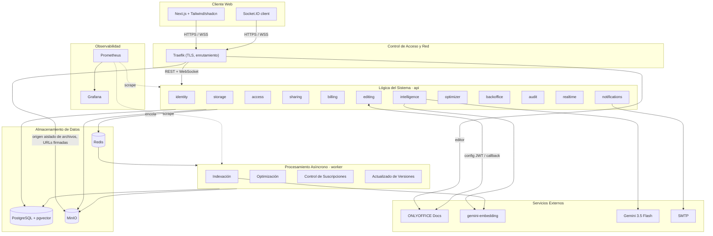

# Arquitectura de Nimbo

> Guardián: subagente `architect`. Todo cambio va con un ADR y con la actualización de los diagramas en `docs/design/diagramas/`.
> Nombres de clases: `docs/sdd/design-model.md`. Problemas conocidos del diseño: `docs/sdd/design-findings.md` (DF-xx).

## 1. Estilo: monolito modular con procesamiento asíncrono

El diagrama de arquitectura define cinco capas: **Cliente Web → Control de Acceso y Red → Lógica del Sistema →
Procesamiento Asíncrono → Almacenamiento de Datos**, más **Servicios Externos**. Se despliega como:

- `web`: Next.js.
- `api`: NestJS con los módulos de la «Lógica del Sistema» (REST + WebSocket).
- `worker`: NestJS standalone con los procesadores y trabajos programados del «Procesamiento Asíncrono» (Indexación,
  Optimización, Control de Suscripciones, Actualizado de Versiones). Usa los mismos módulos que `api`.

Justificación (ADR-0001): 4 personas y 10 semanas no justifican microservicios; las fronteras por módulo permiten
separar uno como servicio el día que haga falta.

**Hospedaje y dominio** (spec 000, D-3 a D-6): DigitalOcean con crédito del GitHub Student Pack. Un Droplet de
**staging** (2 vCPU / 4 GB, Ubuntu LTS + Docker Compose) desde el 30/09/2026 (`workflow.md` §7.2) y un Droplet de **producción** separado
(4 vCPU / 8 GB) en la Fase 4. Dominio `nimbo.me`; en staging Traefik enruta por host con TLS de Let's Encrypt:
`staging.nimbo.me` (web), `api.staging.nimbo.me` (api), `docs.staging.nimbo.me` (ONLYOFFICE, solo con el perfil
activo) y `s3.staging.nimbo.me` (MinIO, habilitado cuando 005 lo necesite). Imágenes en `ghcr.io/afmatul/nimbo-{api,worker,web}`;
despliegue por SSH desde GitHub Actions (`migration:run` antes de `up -d`); rollback = redesplegar la etiqueta anterior.
Solo Traefik publica puertos (80/443). La separación `api`/`worker` es por **proceso e imagen**, no por carpeta (ADR-0001).



Diferencias con el diagrama entregado: ver **DF-28** (flecha Pino→Gemini, embedding de consultas, módulos faltantes,
SMTP, observabilidad, rutas vía Traefik y worker separado).

## 2. Estructura del monorepo

```
nimbo/
├─ compose.yml  compose.override.yml  compose.staging.yml   # en la raíz: `docker compose up -d` sin COMPOSE_FILE
├─ apps/
│  ├─ web/                 # Next.js (App Router)
│  ├─ api/                 # NestJS HTTP + WebSocket
│  │  └─ src/shared/       # módulo transversal T1 (ver §3)
│  │  └─ src/modules/<modulo>/   # aquí viven también los *.processor.ts y *.job.ts de cada módulo
│  └─ worker/              # composición: WorkerModule + main.ts + salud interna; importa `@nimbo/api/*` (solo index.ts)
├─ packages/
│  ├─ contracts/           # DTOs y tipos compartidos web ↔ api (fuente única)
│  └─ config/              # eslint (incl. boundaries.js), tsconfig, jest base
├─ infra/                  # solo configuraciones: traefik/, minio/, deploy/, (022) prometheus/, grafana/, respaldos
├─ docs/operations/        # despliegue, ambientes, rollback (insumo del Manual Técnico)
├─ e2e/  load/  specs/  docs/
```

Los archivos de compose viven en la **raíz** (no en `infra/`) para que los comandos de CLAUDE.md funcionen sin
`COMPOSE_FILE`; `infra/` guarda únicamente configuración de servicios. `worker` importa los módulos de `api` (mismo
código de dominio y aplicación); los procesadores y trabajos viven dentro de cada módulo, el worker solo los compone.
No hay paquete `domain` aparte salvo que un ADR lo justifique.

## 3. Módulos y dependencias

| Módulo | Diagrama | Responsabilidad | Puede depender de |
|---|---|---|---|
| `shared` | T1 (DF-49) | `Actor`, `IClock`, `DomainError` + `DomainExceptionFilter`, logger Pino con redacción, `correlationId`, validación de entorno, `DataSource`, salud (`HealthModule`, `IHealthIndicator`, indicadores Postgres/Redis/MinIO), paginación. Con 001: `IRateLimiter` → `RedisRateLimiter`, `TooManyRequestsError` (429), `ITransactionRunner` + `TransactionContext`, `ZodValidationPipe` (ADR-0020), `configureHttpApp` (solo JSON, CORS, `trust proxy`) y el proveedor `REDIS_CLIENT`. Con 003: guards globales (`JwtAuthGuard`, `RolesGuard`, `@Public`, `@Roles`), el puerto token→`Actor` que implementa `identity` (002 D-14, 003 D-2) y `withActor` (ADR-0005) | — |
| `audit` | T2 (extraído de M8, DF-03) | `AuditService`, `AuditEntry`; declara e implementa `IAuditLogger` (ADR-0010). 005 creó el puerto y el catálogo cerrado `AuditAction`; 004 lo implementa con `AuditService`, persistente en `evento_auditoria` (solo adición, RLS por afectado), con el catálogo `AUDIT_CATALOG` (lista blanca de atributos por acción) y el repositorio interno `IAuditRepository`. `AuditModule` (escritura; lo cargan `api` y `worker`) y `AuditHttpModule` (solo `api`: `GET /audit/my-events`, la actividad propia para los cuatro roles) | shared |
| `notifications` | T4 (DF-34) | Correo y notificaciones; declara e implementa `IMailer` e `INotifier` (ADR-0010). El `api` encola en `mail` y el `worker` entrega por SMTP con nodemailer (ADR-0018) | shared, realtime |
| `realtime` | T3 (generalizado desde M5, DF-30) | Único gateway Socket.IO, salas por usuario y documento; valida el token del handshake con el puerto token→`Actor` de `shared`; declara `IRealtimePublisher` e `IDocumentRooms` y el evento `realtime.document-left` (ADR-0010, ADR-0019, 015) | shared |
| `identity` | M1 | Registro, verificación, login, refresh, sesiones, dispositivos. Publica `identity.client-account-verified` (001, ADR-0019). Con 011 (Propuesto): fachadas de cuentas para `backoffice`. Con 009: `VerifiedClientLister` (en el `worker` por `IdentityReadersModule`) y `AccountContactReader` para `billing`. Implementa `IUserDirectory` (nombres visibles; lo declara `editing`) | shared, notifications, audit, editing (solo para implementar `IUserDirectory`, patrón `billing → storage`; 016, DF-74) |
| `billing` | M4 | Planes, suscripciones, pagos, facturas, renovación; implementa `IPlanLimitsProvider` (declarado por `storage`, DF-51 opción A) e `IAgentQuota`; crea la suscripción Personal al consumir `identity.client-account-verified` | shared, notifications, audit, storage (`IObjectStorage` para facturas y `IPlanLimitsProvider`/`PlanLimits` para implementarlo; solo desde `storage/index.ts`), identity (solo desde su `index.ts`: el evento `identity.client-account-verified`, ADR-0019, y desde la 009 las fachadas de lectura `VerifiedClientLister` y `AccountContactReader`, sin repositorios ni entidades; aprobado por Adrián en la revisión del plan 009, decisión 2, DF-69) |
| `access` | M3a (lectura) | Solo lectura: `PermissionResolver`, políticas, `accessibleNodes(actor)` | shared |
| `storage` | M2 | Nodos, cargas, descargas, papelera, versiones, cuota, búsqueda por metadatos, vista previa. Con 005: `UploadService`, `QuotaService`, `FileService`, cola `upload-cleanup`. Escribe la columna `usuario.espacio_usado` (regla 6, DF-59). **Declara** `IPlanLimitsProvider` y `PlanLimits` en `application/plan-limits.ts` (DF-51, opción A) y no importa `billing` en ningún archivo | shared, access, audit, realtime (arista permitida por ADR-0010, sin uso en 005: el progreso de carga es local del cliente, DF-58; 015 tampoco la usa, P-7) |
| `sharing` | M3b (escritura) | Comparticiones, enlaces públicos, límite de intentos | shared, access, storage, audit |
| `editing` | M5 | Sesiones de edición, presencia, callback, autoría e historial. Declara `IUserDirectory` e `IDocumentEditor`. Procesa `editing-save` en el `api` (ADR-0029) | shared, storage, access, realtime, audit (**sin `billing`**: los límites del plan salen de `IPlanLimitsProvider` de `storage`; mantener `editing → billing` cerraría el ciclo `editing → billing → identity → editing`) |
| `intelligence` | M6 | Indexación, recuperación híbrida, agente con citas; implementa `IIndexQueue` | shared, storage, access, billing (`IAgentQuota`), realtime |
| `optimizer` | M7 | Estimación y optimización de PDF e imágenes | shared, storage, access |
| `backoffice` | M8 | Administración, soporte, métricas, colas (la salud y `RolesGuard` pasaron a `shared`: DF-49, 003 D-2) | shared, audit, identity, billing, storage (fachadas, DF-04) |

**Reglas**
1. El grafo es un DAG. Si dos módulos se necesitan mutuamente, uno define un puerto y el otro lo implementa **sin importar al primero**, o se usa un evento de dominio.
2. Los eventos cruzan fronteras sin acoplar: `ClientAccountVerified` (001), `FileUploaded`, `FileVersionCreated`, `FileTrashed`, `SubscriptionExpired`, `EditSessionClosed`.
   Mecanismo (ADR-0019, Propuesto): `@nestjs/event-emitter` en proceso, publicado después del commit.
   - El productor exporta el contrato del evento (nombre y forma) en su `index.ts`, y el consumidor depende del productor.
   - Los oyentes son idempotentes y, si perder un evento deja datos inconsistentes, el consumidor tiene una conciliación.
   - Si la arista del consumidor hacia el productor creara un ciclo, se vuelve a la regla 1.
3. `access` lee tablas de `storage` y `sharing` por SQL de solo lectura. Es la **única** excepción documentada a «cada módulo es dueño de sus tablas», porque la autorización debe resolverse dentro de la consulta (DF-02, ADR-0010).
4. Otro módulo solo importa desde `modules/<x>/index.ts`: fachadas, puertos que ese módulo implementa, eventos y tipos públicos. Se hace cumplir con lint (ADR-0008).
5. Los transversales (`audit`, `realtime`, `notifications`) declaran sus propios puertos y nunca dependen de un módulo de negocio; entre ellos solo existe `notifications → realtime` (ADR-0010).
6. **Segunda excepción a «cada módulo es dueño de sus tablas» (DF-59, plan 005 D-5)**: `storage` actualiza la columna `usuario.espacio_usado` (la tabla es de `identity`), y **solo esa columna**, con `SELECT espacio_usado … FOR UPDATE` y `UPDATE usuario SET espacio_usado = espacio_usado + $1`, a través de un único puerto, `IQuotaRepository`. Motivo: el espacio solo puede sumarse en la misma transacción que registra `archivo` y `version_archivo` (RN-10, DF-38), y una tabla propia de uso (`cuota_uso`) duplicaría el contador. No es una arista del grafo: `storage` no importa `identity`. Lo hace cumplir una prueba (`quota.repository.int-spec.ts`: ninguna otra columna cambia), un *fixture* negativo de `boundaries.js` (`storage-imports-identity.ts`) y la revisión del `architect`. Ningún otro módulo copia el patrón sin un DF y un ADR.

**DF-51 (opción A, Fátima, 2026-09-28)**: `storage` declara `IPlanLimitsProvider`, `PlanLimits` e `I_PLAN_LIMITS_PROVIDER` y `billing` los implementa importándolos de `storage/index.ts`; el ciclo `storage ↔ billing` desaparece y queda solo `billing → storage`. `editing` reutiliza el puerto desde `storage`. Con 016 (DF-73) `PlanLimits` suma `retainedVersions` (límite de almacenamiento: la poda es de `storage`) y `maxEditors` (lo consume `editing`, pero se acepta ensanchar el tipo porque `PlanLimitsAdapter.toLimits` ya lee la fila y un segundo puerto de `billing` sería una abstracción de una sola fila; a la tercera familia de límites ajenos a `storage` se separa en un puerto propio). Con la 010 (ADR-0032, regla 1) `PlanLimits` describe las **condiciones de almacenamiento de la cuenta del actor** que consume `storage`: límites, retención, nombre visible y `readOnly`; otro módulo que necesite algo que `storage` no consume lo pide por un puerto de `billing`. El enlace del token vive en la raíz de composición (`AppModule`). `boundaries.js` prohíbe cualquier import de `billing` desde `storage`.

**Pendiente (PD-18)**: §5 aún no coincide con la tabla en `IAgentQuota` (lo declara e implementa `billing`; `intelligence → billing` ya existe) ni en `IIndexQueue` (propuesta: lo declara `storage`, quien encola, y lo implementa `intelligence`, que ya depende de `storage`). Se confirma en el plan de 019 (indexación); 005 no emite `FileVersionCreated` ni lo necesita (D-16).

## 4. Capas dentro de un módulo

```
modules/storage/
├─ domain/                   # StorageNode, Folder, File, FileVersion, UploadSession, errores. Sin Nest ni TypeORM.
├─ application/
│  ├─ ports/                 # i-object-storage.port.ts, i-node-repository.port.ts, i-file-type-detector.port.ts,
│  │                         # i-upload-session-repository.port.ts, i-quota-repository.port.ts, i-expired-upload-scanner.port.ts (005)
│  ├─ plan-limits.ts         # DECLARA IPlanLimitsProvider, PlanLimits e I_PLAN_LIMITS_PROVIDER (DF-51, opción A); billing los implementa
│  ├─ file.service.ts        # «service» de los diagramas
│  ├─ upload.service.ts
│  └─ quota.service.ts
├─ infrastructure/
│  ├─ persistence/           # *.orm-entity.ts (@Entity('archivo')), repositorios, mappers
│  ├─ minio-storage.adapter.ts
│  └─ magic-bytes.detector.ts
├─ presentation/
│  ├─ uploads.controller.ts  # init, resume, complete, cancel (005: sin uploadPart, DF-16)
│  └─ files.controller.ts
├─ storage.module.ts
└─ index.ts                  # API pública del módulo
```

- `domain` no importa nada fuera de `domain` y `shared/domain`.
- Los servicios de aplicación (`«service»`) orquestan: reciben `actor: Actor` como primer parámetro (DF-01), usan puertos y delegan reglas en el dominio.
- `infrastructure` es el único lugar con TypeORM, SDKs, Redis, BullMQ y procesos externos.
- Los controladores validan, mapean y delegan. No tienen reglas de negocio.
- Mapeo ORM ↔ dominio en `infrastructure/persistence/*.mapper.ts`. En módulos triviales se permite usar la entidad ORM directamente si el plan lo justifica.

## 5. Puertos (según diagramas de clases)

| Puerto | Implementación | Módulo dueño del puerto → implementador |
|---|---|---|
| `IPasswordHasher` | `Argon2idHasher` | identity (también lo usa sharing, DF-10) |
| `ITokenService` | `JwtTokenService` | identity |
| Puerto token→`Actor` (nombre en el plan 003) | verificador de `identity` (002 D-14) | shared → identity (lo usan `JwtAuthGuard` y el handshake de `realtime`, sin importar `identity`) |
| `IMailer` | `SmtpMailer` (encola en `mail`; `MailProcessor` + `SmtpTransport` entregan en el `worker`; Mailpit en local, SMTP de Resend en staging, ADR-0018) | notifications (lo declara y lo implementa; lo consume identity, ADR-0010) |
| `IAccountEventsPublisher` | `EventEmitterAccountEventsPublisher` | identity (publica `identity.client-account-verified` después del commit, ADR-0019) |
| `IObjectStorage` | `MinioStorageAdapter` (dos clientes S3: interno y de firma con el host público; `@aws-sdk/s3-request-presigner`, adenda de ADR-0015) | storage. Con 005 incluye `presignUploadPart`, `presignUploadObject`, `listParts`, `purgeObject` (borra todas las versiones: el bucket es versionado) y `presignDownload` (DF-16) |
| `IFileTypeDetector` | `MagicBytesDetector` | storage |
| `IPlanLimitsProvider` | fachada de billing | lo declara `storage` (`application/plan-limits.ts`); lo implementa `billing` importándolo de `storage`; lo reutiliza `editing` (DF-51, opción A) |
| `IAccessPolicy` | `OwnerPolicy`, `EditorPolicy`, `ViewerPolicy` | access |
| `IRateLimiter` | `RedisRateLimiter` | shared (lo declara y lo implementa; lo consumen identity desde 001 y sharing desde 012; `identity → sharing` no está permitido, ADR-0010) |
| `IAuditLogger` | `AuditService` (004, persistente en `evento_auditoria`) | audit (lo declara y lo implementa; lo consumen los módulos que auditan, ADR-0010). Contrato mixto (004 D-5): `record` es de mejor esfuerzo, posterior al commit y nunca lanza (005, 006); `recordInTransaction` es síncrona, se une a la transacción del mismo actor y lanza si no puede guardar (011); con el actor de sistema (`AuditActor = Actor \| SystemActor`, solo en `audit`, CA-7 de 011) se une al `run` sin actor del llamador. La acción sale del catálogo cerrado `AuditAction` y los atributos se sanean con la lista blanca de `AUDIT_CATALOG` |
| `IPaymentGateway` | `SimulatedPaymentGateway` | billing |
| `IInvoiceGenerator` | `PdfInvoiceGenerator` | billing |
| `INotifier` | notifications | notifications (lo declara y lo implementa; lo consume billing, ADR-0010) |
| `IRealtimePublisher` | `SocketIoHub` (015) | realtime (lo declara y lo implementa; lo consumen storage, editing, intelligence y notifications, ADR-0010) |
| `IDocumentRooms` | `SocketIoHub` (015) | realtime (lo declara y lo implementa; solo el módulo dueño de la sala, `editing`; evento de salida `realtime.document-left`, ADR-0019) |
| `IClock` | `SystemClock` / `FixedClock` | shared |
| `ITransactionRunner` | TypeORM sobre `TransactionContext` (`AsyncLocalStorage`) | shared (lo consumen los servicios que escriben en más de una tabla; `withActor` de 003 usa el mismo contexto). Con 011 (Propuesto, T1, DF-65): `run` se une a **cualquier** transacción en curso, con o sin actor (antes solo a un `withActor`); `withActor` dentro de un `run` sin actor sigue lanzando |
| `IDocumentEditor` | `OnlyOfficeEditor` (ADR-0004) | editing |
| `IUserDirectory` | `UserDirectoryAdapter` (016, DF-74) | lo declara `editing`; lo implementa `identity` importándolo de `editing/index.ts`; se enlaza en la raíz (`UserDirectoryBindingModule`). Recibe ids de participantes y devuelve solo el nombre visible (excepción de §6 punto 9) |
| `IIndexQueue` | cola BullMQ `indexing` | editing → intelligence |
| `ILanguageModel` | `GeminiFlashModel` | intelligence |
| `IEmbeddingProvider` | `GeminiEmbeddingProvider` (dimensión 768) | intelligence |
| `ITextExtractor` | `DocxExtractor`, `PdfExtractor`, `PlainTextExtractor` | intelligence |
| `IAgentQuota` | fachada de billing | intelligence → billing |
| `IOptimizer` | `PdfOptimizer`, `ImageOptimizer` (vía `BaseOptimizer`) | optimizer |
| `IIntegrityValidator` | `DefaultIntegrityValidator` | optimizer |
| `ICommandRunner` | `ChildProcessRunner` | optimizer |
| `IHealthIndicator` | `PostgresHealthIndicator`, `RedisHealthIndicator`, `MinioHealthIndicator` (shared); ~~`OnlyOfficeHealthIndicator` (editing, DF-29)~~ omitido (PD-113): `editing` revisa ONLYOFFICE con `IDocumentEditor.isAvailable` al abrir | shared (DF-49); cada módulo puede aportar un indicador y la raíz de composición lo registra en `HealthModule.forRoot({ indicators })` |
| `IQueueInspector` | `BullMqInspector` | backoffice |
| `INodeMetadataReader` | `SqlNodeMetadataReader` (solo columnas de `archivo`, dentro de `withActor` y con RLS) | storage (lo **declara e implementa**; lo consume `backoffice`, arista `backoffice → storage`; sin `storage → backoffice`, cierra PD-31). Plan 011, Propuesto |
| Repositorios `I*Repository` | TypeORM | cada módulo. `storage` (005) agrega `IUploadSessionRepository`, `IQuotaRepository` (único punto que toca `usuario`, regla 6 de §3) e `IExpiredUploadScanner` (único acceso sin actor, §6 punto 6) |

Todo adaptador externo tiene una prueba de contrato compartida (Liskov).

## 6. Autorización dentro de la consulta

```ts
// shared/domain/actor.ts
export interface Actor {
  readonly id: string;
  readonly role: Role;            // CLIENT | ADMIN | SUPPORT | OPERATOR
  readonly canReadContent: boolean; // true solo para CLIENT
}
```

1. Guards globales en `shared`, no en M8 (spec 003 D-2, DF-50), que niegan por defecto: `JwtAuthGuard` verifica el token con el puerto token→`Actor` de `shared` (lo implementa `identity`, 002 D-14) y construye el `Actor`; `RolesGuard` valida el rol requerido por `@Roles()`; solo las rutas con `@Public()` se atienden sin sesión.
2. Los servicios reciben `actor` y los repositorios de datos de cliente solo exponen `findAccessible(actor, …)`.
3. `access.accessibleNodes(actor)` es el CTE único que une propiedad, comparticiones y herencia por `carpeta.ruta`. Lo usan listados, búsqueda, descargas, vista previa, edición y el agente (DF-32).
   - **Excepción acotada** (spec 006 SEC-2): las filas de metadatos propias de la cuenta, con clave `usuario_id` y RLS por usuario, que no leen ni devuelven datos de nodos (p. ej. la poda de `acceso_rapido`, que debe alcanzar nodos en la papelera o de comparticiones revocadas) pueden operar sin unir `accessibleNodes`. Nunca aplica a tablas de contenido ni a lecturas que devuelvan nodos.
4. `PermissionResolver.can(actor, nodeId, action)` sirve para validar una acción sobre un recurso puntual, usando las políticas Strategy.
5. Roles internos: `SupportService` usa `INodeMetadataReader`, que por construcción no devuelve `clave_objeto`, URLs ni texto.
6. **Segunda barrera** (ADR-0005, enmendado por ADR-0021): RLS con `ENABLE` y `FORCE ROW LEVEL SECURITY` en `archivo`, `version_archivo` y `carga` (desde las migraciones de 005) y en `fragmento` (019). `carga` no es un nodo: se filtra con `propietario_id = actor.id` en la consulta y por RLS, sin política para roles internos.
   - **Roles de BD**: `api` y `worker` se conectan por `DATABASE_URL` como `nimbo_app` (`LOGIN`, `NOSUPERUSER`, `NOBYPASSRLS`, no dueño de las tablas). El rol dueño solo lo usan las migraciones, por `DATABASE_MIGRATION_URL`, que leen `migrations/data-source.cli.ts` y `scripts/migrate.ts` y que queda fuera del esquema de entorno de `api` y `worker`.
   - **Actor por transacción**: `withActor(actor, trabajo)` (`shared/infrastructure/persistence`) abre `DataSource.transaction` y su primera sentencia es `SELECT set_config('app.actor_id', $1, true), set_config('app.actor_role', $2, true)` (equivale a `SET LOCAL`, con parámetros enlazados). Publica el `EntityManager` en `AsyncLocalStorage`; los repositorios de datos de cliente fallan si no existe. Solo `withActor` escribe esas variables (regla de lint).
   - **Políticas cerradas**: sin actor no hay filas. `CLIENT` ve las suyas (y las compartidas desde 012); `OPERATOR`, ninguna; `ADMIN` y `SUPPORT` solo leen metadatos de `archivo` y **no reciben filas de `version_archivo`** (contiene `clave_objeto`). El detalle se fija en el plan de 005.
   - **Worker**: mismo `nimbo_app`, sin `BYPASSRLS`; un trabajo sobre un archivo actúa como el dueño de su payload. **Mantenimiento sin actor** (DF-52, ADR-0021 Propuesto, opción B): una función `SECURITY DEFINER` mínima, propiedad del rol que migra, con `REVOKE … FROM PUBLIC` y `EXECUTE` solo para `nimbo_app`, devuelve únicamente identificadores `(id, propietario_id)` de filas vencidas (`carga_expiradas` en 005; el patrón sirve a la purga de 006 y a la conciliación de 007); después el trabajo corre `withActor(createActor(propietario_id, CLIENT), …)` por dueño, con RLS normal. Como `FORCE` somete también al dueño, la función tiene su propia política (`carga_mantenimiento`, `TO CURRENT_USER`); un superusuario ignora RLS, así que la prueba de mantenimiento debe correr con un dueño sin `SUPERUSER`. `nimbo_app` sin actor sigue viendo 0 filas por consulta directa. Los accesos sin actor en `storage` son `IExpiredUploadScanner` (005) e `IExpiredTrashScanner` (006), que solo inyectan sus procesadores, e `IClientAccountScanner` (007); en `billing`, `suscripciones_por_renovar` y `suscripciones_por_avisar` (010, `IDueSubscriptionScanner`, funciones `SECURITY DEFINER` con su política `suscripcion_mantenimiento`); fuera de `storage`, el alta inicial de 011 (CA-7, Propuesto): el script `admin:bootstrap` abre **un** `run` sin actor (T1) que escribe `usuario` y `token_cuenta` (sin RLS) y un único evento `SYSTEM` que solo admite la política `evento_auditoria_alta_sistema` (`account.bootstrap_admin`, sin afectado). La conciliación de `espacio_usado` no usa función `SECURITY DEFINER` porque `usuario` no tiene RLS; lista solo ids con un `SELECT id FROM usuario WHERE rol = 'CLIENT'` por páginas y después mide y corrige como cada dueño con RLS normal (extensión de DF-59, DF-62).
   - **Pendiente**: hoy (000) `api`, `worker` y migraciones comparten una `DATABASE_URL` con el superusuario de `compose.yml`. Los dos roles en compose (script de inicio de Postgres) y staging (GitHub Environments), `DATABASE_MIGRATION_URL` en `.env.example` y en `pnpm env:check`, `withActor` y la regla de lint los entrega el plan de la spec 003 (D-7); las políticas de `archivo`, `version_archivo` y `carga` y la función de mantenimiento, el plan de 005.
7. **Agente**: `HybridRetriever` filtra `fragmento.archivo_id IN (accessibleNodes)` antes del `ORDER BY embedding <=> $q LIMIT topK` (DF-14).
8. Suite `test/isolation`: cuentas con contenido casi idéntico; cualquier fuga rompe CI. Corre con los dos roles de BD reales, nunca como superusuario (ADR-0005).
9. **`IUserDirectory` sin `actor`** (016, DF-74): `displayNames(userIds)` devuelve `id → nombre` de cuentas que `editing` ya autorizó como participantes de una sesión (el nombre visible a los coeditores es el comportamiento pedido, 016 CA-6). `usuario` no tiene RLS (§6.6), así que el adaptador lee solo `id` y `nombre` con `WHERE id = ANY($1)` y no devuelve correo, rol ni estado. Es un segundo caso acotado del punto 3 (no devuelve nodos ni contenido); el token `I_USER_DIRECTORY` solo se resuelve en `editing` (el módulo de enlace no lo exporta globalmente).

## 7. Flujos críticos (con clases de los diagramas)

### 7.1 Carga simple y por partes (RF-08, RF-12, RF-14; plan 005)
Los bytes **nunca pasan por la API** (DF-16): el navegador sube y baja directo de MinIO con URLs prefirmadas contra el host público de MinIO (origen aislado, RNF-07).
1. `UploadsController.init` → `UploadService.init(actor, request)`: límite de tasa (`IRateLimiter`) → validación de forma y de `FileName` → `IPlanLimitsProvider.limitsFor(actor)` (fuera de la transacción) → `withActor`: `IQuotaRepository.lockAndReadUsage` (`FOR UPDATE` sobre `usuario` + suma de las `carga` activas no vencidas) → `QuotaService.assertCanUpload` (máximo por archivo, luego cuota) → nombre repetido (409 con `suggestedName` si `onConflict='ask'`) → modo por umbral de configuración: **simple** (un `PUT` prefirmado) o **por partes** (`IObjectStorage.createMultipart`, una URL por parte con `presignUploadPart`) → se inserta la fila `carga` `activa`, que **es** la reserva de cuota.
2. El navegador sube directo a MinIO. El progreso (porcentaje, bytes, velocidad, tiempo restante) lo mide el propio navegador y **no pasa por `realtime` ni por la API** (DF-58) y no se difunde a otras pestañas (015 P-7). Para reanudar, `UploadService.resume` renueva las URLs de las partes faltantes según `listParts`; una carga simple pausada empieza de cero.
3. `UploadsController.complete` → `UploadService.complete(actor, uploadId)`: el servidor **lista las partes él mismo** (`listParts`, no confía en ETags del cliente) → valida tamaño real → `completeMultipart` → `IFileTypeDetector.detect` por rangos (`getRange`) → en una transacción: `archivo` + `version_archivo(origen=carga)` + `usuario.espacio_usado` + `carga` a `completada` (compare-and-set). Idempotente: repetirlo devuelve el mismo archivo. **No se emite `FileVersionCreated`** en 005 (sin consumidor hasta 019, que añade `IIndexQueue`).
4. Si la validación falla, `purgeObject` (borra **todas** las versiones del objeto: el bucket está versionado) y la carga queda `rechazada` con motivo. `cancel` y `expire` hacen **CAS primero** (`activa → cancelada|expirada`, lo que libera la reserva y descarta cualquier `complete` en curso) y **borran después** (`abortMultipart` o `purgeObject`); el residuo posible es un objeto huérfano sin `archivo`, que no cuenta en la cuota.
5. Toda carga sin completar expira a las 24 h: la limpia el trabajo repetible `upload-cleanup` (§8), y el vencimiento se aplica también de forma perezosa en `resume` y `complete`.

### 7.2 Edición y guardado (RF-25, 26, 28, DF-05, DF-20)
1. `EditorController.open` → `EditSessionService.open(actor, fileId)` → `accessibleNodes(actor)` + `PermissionResolver` (access), plan de la **cuenta propietaria** y `maxEditors` por `IPlanLimitsProvider` (storage) → `EditModePolicy` (modo o solo lectura con motivo) → `IDocumentEditor.signConfig` (JWT firmado).
2. `editing` autoriza la sala del documento consultando `access` y une la conexión con `IDocumentRooms.admit` (sale con `retire` o al escuchar `realtime.document-left`, 015); la presencia se difunde por el gateway único de `realtime` (DF-30, ADR-0010); `Participant` registra entrada y salida.
3. ONLYOFFICE llama `EditorController.callback` con `status`: 1 editando · 2 listo para guardar · 3 error · 4 cerrado sin cambios · 6 guardado forzado · 7 error de guardado forzado.
4. `SaveCallbackHandler`: `verifyCallback` (JWT, se usa el payload firmado) → estado 2: CAS `activa → guardando` y encola `editing-save` (`jobId` = sesión) → responde `{"error":0}`.
5. Procesador `editing-save` (**en el `api`, concurrencia 1, ADR-0029**: las salas de 015 viven en su memoria): descarga la URL (origen de la lista blanca de ONLYOFFICE, tope de bytes) → verifica que sea un `.docx` íntegro → `EditableFileGateway.registerEditedVersion` (`storage`): transacción `version_archivo(origen=edicion, sesion_edicion_id UNIQUE)` + puntero de versión vigente + `addUsedBytes` sin validar cuota + retención → `EditSession.close()` → encola `IIndexQueue`. La idempotencia es la restricción `UNIQUE` (DF-05, DF-72); no hay candado de Redis. Una violación del `UNIQUE` en un reintento se trata como éxito.
6. Si falla (documento no íntegro o descarga rechazada: `integridad`; archivo purgado: `archivo_purgado`; estado 3: `editor`; tras agotar los intentos: `almacenamiento`): `SaveFailedNotifier` aplica `EditSession.fail` con su motivo, la versión anterior queda intacta y `editing` avisa a cada participante y a la propietaria con `IRealtimePublisher.toUser` (`editing.save-failed`); al reabrir, `lastSaveFailed` muestra el banner.

### 7.3 Indexación (RF-30, RNF-03)
`FileVersionCreated` → `IIndexQueue` → `IndexingService.indexFile` → `ExtractorRegistry.forMime` → `ITextExtractor.extract` → `Segment[]` con procedencia →
`Chunker.split` (nunca une segmentos de distinta ubicación: `sameLocation`) → `IEmbeddingProvider.embed` por lotes →
`fragmento` (`archivo_id`, `version_archivo_id`, `procedencia jsonb`, `vector(768)`, `tsvector`) → `indexacion.estado`.
PDF sin capa de texto → `markUnindexable`.

### 7.4 Consulta al agente (RF-32–34)
`AgentController` → `AgentService.ask(actor, q)` → `IAgentQuota.consume` → `HybridRetriever.retrieve` (embedding de la pregunta +
`keywordSearch` + `vectorSearch`, ambas restringidas; `fuse` por RRF) → `buildPrompt` con fragmentos numerados (el contenido se
trata como datos, no como instrucciones) → `ILanguageModel.stream` → `realtime` → `attachCitations` valida que cada cita
corresponda a un fragmento recuperado; si `SourceLocation.isCertain()` es falso, la respuesta lo dice → se guardan `consulta_agente`
y `cita` como instantánea (DF-08).

### 7.5 Renovación y solo lectura (RF-22–24)
`RenewalScheduler` (cola `subscription-renewal` con `upsertJobScheduler`, en el `worker`) lista con funciones de mantenimiento
(ADR-0021: `suscripciones_por_renovar` y `suscripciones_por_avisar`) y `RenewalRunner` renueva, vence o avisa cada cuenta como su
dueño (`SubscriptionRenewer`, `RenewalReminderService`), con la fila bloqueada (`FOR UPDATE`): `RenewalCheckout` cobra el plan del
siguiente ciclo (`chooseNextCycle`, RN-4 y CA-29) con la referencia del último pago aprobado (ADR-0031); si se rechaza o no hay con
qué cobrar, `expire()` deja la cuenta en solo lectura con su plan. La solo lectura la comprueban los servicios de escritura de cada
módulo con `PlanLimits.readOnly` (ADR-0032; en `storage`, `WritableAccountPolicy`; en `editing`, `EditModePolicy`); no hay guard
global. Si la pasada falla, se dispara una alerta.

### 7.6 Optimización (RF-35, RF-36, DF-21)
`OptimizerController.estimate` → `OptimizationService.estimate` → `IOptimizer.estimate` → `SavingsEstimate.isWorthIt(min)`; si no conviene, no se ofrece.
`run` → `OptimizationJob` → `OptimizationProcessor` → `optimize` → `IIntegrityValidator.validate` → nueva `version_archivo(origen=optimizacion)`;
el original sigue restaurable durante la retención definida en DF-21.

## 8. Colas y trabajos (worker)

| Cola / trabajo | Productor | Reintentos | Idempotencia |
|---|---|---|---|
| `indexing` | `IIndexQueue` | 3, backoff exponencial | por `version_archivo_id` |
| `editing-save` (**procesada en el `api`**, concurrencia 1, ADR-0029) | `SaveCallbackHandler` | 3, backoff exponencial | CAS `activa → guardando` + `UNIQUE sesion_edicion_id` (sin candado Redis, DF-72) |
| `optimization` | `OptimizationService` | 2 | por `optimizacion.id` |
| `subscription-renewal` (repetible con `upsertJobScheduler`, cada `SUBSCRIPTION_RENEWAL_INTERVAL_MINUTES`, 010) | `RenewalScheduler` (worker, al arrancar) | 3, backoff exponencial; concurrencia 1 | idempotente por suscripción y `vence_en` con `FOR UPDATE`; lista con funciones de mantenimiento (ADR-0021) y renueva como cada dueño bajo RLS; alerta en fallo |
| `mail` | `SmtpMailer` (notifications) | 5 (`attempts: 6`, exponencial desde 5 s) | por `idempotencyKey` del productor como `jobId` (sin `:`) + marca `mail:sent:<jobId>` en Redis + `Message-ID` determinista (ADR-0018); no usa `notificacion` |
| `upload-cleanup` (repetible con `upsertJobScheduler`, cada `UPLOAD_CLEANUP_INTERVAL_MINUTES`, 005) | `UploadCleanupScheduler` (worker, al arrancar) | 3, backoff exponencial; concurrencia 1 | compare-and-set sobre `carga.estado`; opera bajo RLS con la función de mantenimiento de ADR-0021 |
| `trash-purge` (repetible con `upsertJobScheduler`, cada `TRASH_PURGE_INTERVAL_MINUTES`, 006; DF-61) | `TrashPurgeScheduler` (worker, al arrancar) y «Vaciar» (`TrashPurgeQueue`) | 3, backoff exponencial; concurrencia 1 | naturalmente idempotente; opera bajo RLS sin actor con el patrón de ADR-0021 (DF-52) |
| `usage-reconcile` (repetible con `upsertJobScheduler`, cada `USAGE_RECONCILE_INTERVAL_MINUTES`, por defecto un día; 007, DF-62) | `UsageReconcileScheduler` (worker, al arrancar) | 3, backoff exponencial; concurrencia 1 | idempotente: por cuenta, `lockUsage` → medir → `addUsedBytes(diferencia)`; una cuenta coherente no cambia. Lista ids con `IClientAccountScanner` (sin actor) y concilia como cada dueño bajo RLS |

## 9. Frontend

```
apps/web/src/
├─ app/                    # (public), (auth), (app)/files, (app)/billing, (app)/agent, (app)/editor/[fileId], (backoffice)
├─ features/<modulo>/      # components/, hooks/, api.ts — una carpeta por módulo de los diagramas
├─ components/ui/          # shadcn/ui con tema Cielo Sereno
├─ components/nimbo/       # FileTypeChip, QuotaBar, VersionTimeline, AgentPanel, CitationChip… (ui-guidelines §4)
├─ app/globals.css         # única fuente de tokens (ui-guidelines §3)
└─ lib/                    # cliente HTTP, socket, formateadores, catálogo de errores
```
- Sistema de diseño: Cielo Sereno, aplicado según `docs/sdd/ui-guidelines.md`. Los mockups de `docs/design/mockups/` son referencia.
- Server Components por defecto; tipos desde `packages/contracts`.
- El editor ONLYOFFICE se embebe con la configuración firmada que devuelve la API.
- Ocultar un botón es UX, no seguridad.

## 10. ADRs

| ADR | Decisión |
|---|---|
| 0001 | Monolito modular con worker separado |
| 0002 | NestJS + TypeORM con migraciones manuales |
| 0003 | PostgreSQL + pgvector, `vector(768)` |
| 0004 | ONLYOFFICE Docs solo para `.docx` |
| 0005 | Autorización en la consulta + RLS |
| 0006 | Pagos simulados detrás de `IPaymentGateway` |
| 0007 | Modelo de lenguaje detrás de `ILanguageModel` / `IEmbeddingProvider` |
| 0008 | Verificación automática de fronteras entre módulos |
| 0009 | Crystal Clear + SDD |
| 0010 | Separar M3 en `access` y `sharing`; extraer `audit`, `realtime`, `notifications` (DF-02, 03, 30, 34) |
| 0011 | Modelo de nodos: tablas `archivo` y `carpeta` separadas con `CHECK` (DF-40; Propuesto) |
| 0012 | Versiones: composición con `origen` en lugar de herencia entre módulos (DF-17, DF-18; Propuesto) |
| 0013 | Política del original en el optimizador (DF-21) |
| 0014 | Tokens de Cielo Sereno ajustados a AA y mapeados a shadcn (DF-41–48) |
| 0015 | Dependencias de fundaciones: gitleaks, zod, nestjs-pino, Testcontainers (menor) |
| 0017 | Dependencias de autenticación: `argon2`, `@nestjs/throttler`, `@nestjs/jwt` (menor; Propuesto) |
| 0018 | Correo con nodemailer por SMTP y la cola `mail` (menor; Propuesto) |
| 0019 | Eventos de dominio en proceso; el contrato lo exporta el productor (Propuesto) |
| 0020 | Validación HTTP con zod desde `contracts`, enmienda 0015 b (Propuesto) |
| 0021 | Mantenimiento sin actor bajo RLS: función `SECURITY DEFINER` mínima y RLS también en `carga`; enmienda 0005 (Propuesto) |
| 0029 | `editing-save` se procesa en el `api`; excepción acotada a ADR-0001 (Aceptado) |
| 0030 | Socket.IO en el `api` sin adaptador de Redis (Aceptado) |
