# T-09 (spec 022): demo en local, resultados y evidencias

| Campo | Valor |
|---|---|
| Primera ronda | 2026-11-03, de 21:07 a 23:50 (hora local, UTC−6), sobre `114a024e` |
| Segunda ronda | 2026-11-04, de 06:15 a 07:02, sobre `fd95398a`: verifica las correcciones de H-1, H-4 y H-6 (`e8765667` y `fd95398a`) y ejecuta CA-11, que Matul pidió como obligatoria |
| Ejecutó | Abel, con apoyo de Claude Code. Las demos no cambiaron ningún archivo versionado |
| Estado | **Completada.** T-09 marcada en `tasks.md`; abiertos PD-172, PD-173 (CA-3 parcial) y PD-189 |

## Ambiente

| Componente | Detalle |
|---|---|
| Máquina | Windows 11, Docker Desktop 29.8.1 sobre WSL2, Node 22.23.4 y pnpm 10.33.0 |
| Compose | Proyecto aislado `nimbo-t09` (`COMPOSE_PROJECT_NAME` y un archivo de puertos local, no versionado), arrancado desde volúmenes vacíos. Las 47 migraciones se aplicaron solo en su base. El proyecto de 021 en la misma máquina no se tocó |
| Observabilidad | Prometheus v3.15.0, Grafana 13.2.4, cAdvisor v0.60.6 y Mailpit |
| Datos | Solo sintéticos (`demo-N-…@nimbo.local`) |
| Cuentas de Grafana | `operador` (*Editor*) y `administrador` (*Viewer*). Sus contraseñas, aleatorias, quedaron solo en la máquina local |

## Estado por criterio

| CA | Estado | Resumen |
|---|---|---|
| CA-9 | ✅ Aprobado | API: 34 de 34 comprobaciones. Además, verificación visual |
| CA-10 | ✅ Aprobado | Todo aprovisionado desde volúmenes vacíos, con `provenance: file`. Además, verificación visual |
| CA-5 | ✅ Aprobado | Las 375 series `nimbo_*` no tienen UUID, correos, `?` ni identificadores |
| CA-18 | ✅ Aprobado | Dos pruebas reales; la segunda, limpia, con `[FIRING]` y `[RESOLVED]` en Mailpit |
| CA-11 | ✅ Aprobado (segunda ronda) | Con solo Postgres de `nimbo-t09` detenido, la tasa de 5xx llegó al 50 %, la regla pasó a Firing y llegaron `[FIRING:1]` y `[RESOLVED]` a Mailpit |
| CA-6 | ✅ Aprobado (segunda ronda) | Los 15 paneles se revisaron. H-4 está corregido: el panel 3 muestra 0 % sin errores |
| CA-14 | ✅ Corregido (segunda ronda) | Con H-1 corregido, la regla de disco volvió a Normal y el panel 14 ya no muestra `/dev/loop*` |
| CA-3 | ❌ Falla parcial en Docker Desktop | CPU, memoria y dependencias se ven. Falta el disco por contenedor: el panel 15 no tiene series (H-2, ahora PD-173) |

## Preparación (21:20)

| Comprobación | Resultado |
|---|---|
| `docker compose up -d --wait` con volúmenes nuevos | 9 servicios arriba |
| `migration:run` | 47 migraciones en la base de la T-09 |
| `pnpm dev` | api (3000), web (3002), worker (3001) y worker-optimizer (3003) en `200` |
| `/metrics` | `:9464`, `:3001` y `:3003` en `200`. `:3000/metrics`, `/api/v1/metrics` y por Traefik dan `404` (no se exponen) |
| Prometheus | Objetivos `api`, `worker`, `worker-optimizer` y `cadvisor` en `up`. `nimbo_dependency_up` = 1 en las 5 series |

## CA-9: acceso y permisos

**Comprobaciones por API: 34 de 34.**

| Comprobación | Resultado |
|---|---|
| Anónimo: tablero, búsqueda y fuentes de datos | `401` |
| Anónimo abre `/d/nimbo-operacion` | `302` → `/login?redirectTo=…` |
| Anónimo `POST /api/user/signup`; credencial sin cuenta de Grafana (Cliente o Soporte) | `401`; `401` |
| Acceso anónimo, tableros públicos, instantáneas externas | deshabilitados |
| *Viewer* lee el tablero, consulta la fuente de los paneles y ve el estado de las reglas | `200`; `canSave` y `canEdit` en falso |
| *Viewer* guarda, crea o borra un tablero | `403` |
| *Viewer* modifica o borra una regla (provisioning), reescribe el grupo (ruler) o cambia el punto de contacto | `403` |
| *Viewer* sin `datasources:explore`; el Operador (*Editor*) sí lo tiene | correcto |

**Verificación visual.** El acceso anónimo no tiene captura; su evidencia es la tabla de arriba.

Inicio con *Viewer*: el menú solo ofrece Bookmarks, Starred, Dashboards y Alerting, sin Explore ni Administration.

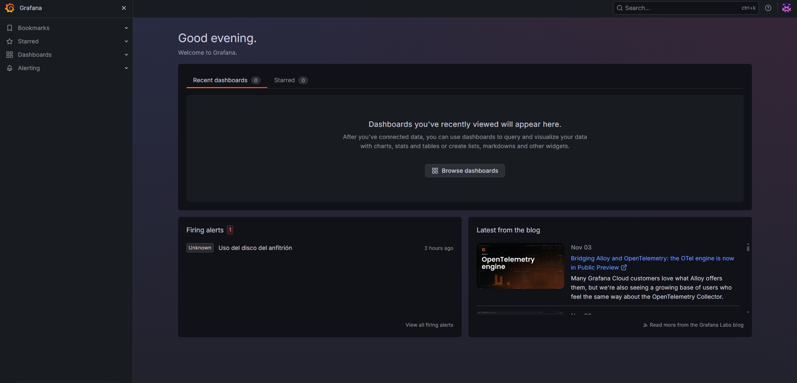

*Viewer* dentro del tablero «Operación», sin el botón *Make editable* que sí aparece en la captura 07.

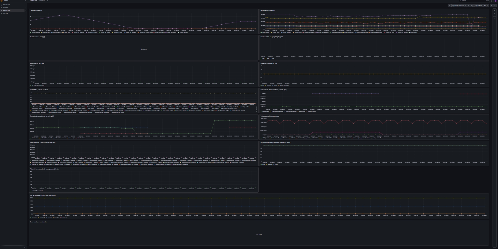

Inicio con *Viewer* después de abrir el tablero; sigue sin Explore.

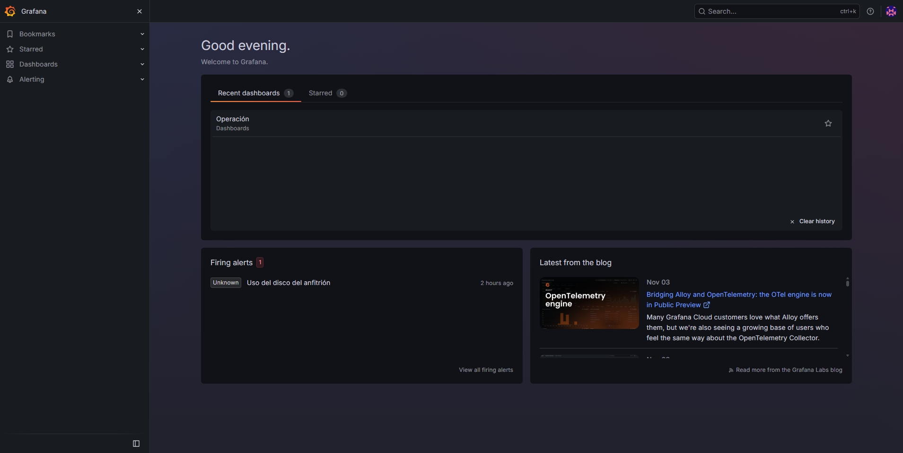

Menú **More** de «Dependencia caída» con *Viewer*: solo *Copy link* y *Export*, sin editar ni borrar.

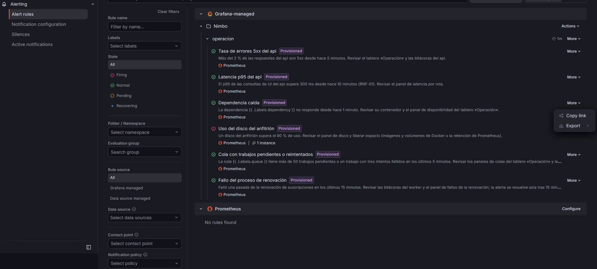

## CA-10: aprovisionamiento

Al primer arranque desde volúmenes vacíos ya estaban la fuente Prometheus (solo lectura), el tablero «Operación» (15 paneles), las 6 reglas, `correo-equipo` y la política hacia él, todo con `provenance: file`. Por API, el Operador (*Editor*) tampoco puede cambiar lo aprovisionado: el tablero devuelve `400`, la regla `409` y el grupo de reglas `400`.

Las 6 reglas de la carpeta `Nimbo`, grupo `operacion`, tienen la marca **Provisioned**. «Uso del disco del anfitrión» aparece disparada por H-1.

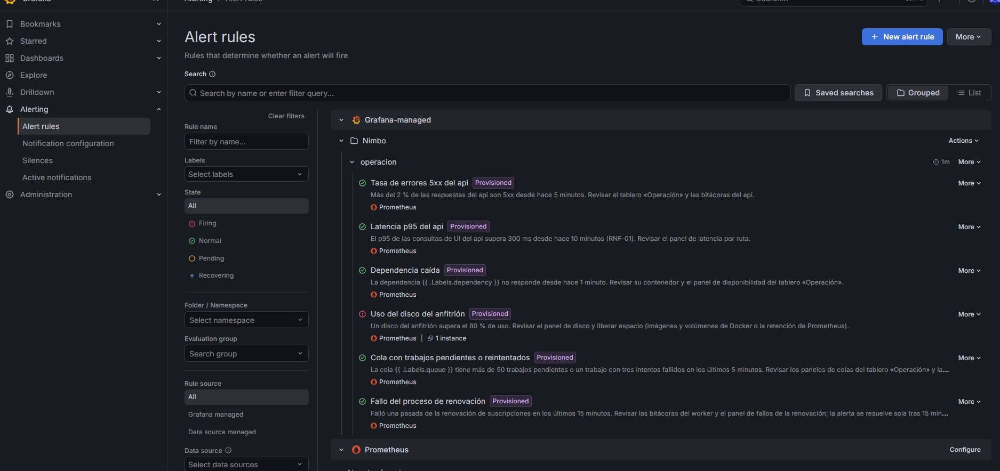

`correo-equipo` → `equipo@nimbo.local`, **Provisioned** y usado por 1 política. El punto de contacto `empty` (*Unused*) es el que Grafana trae por omisión; no lo usa ninguna política.

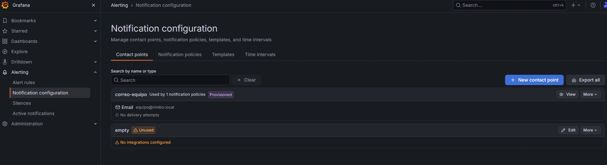

## CA-6 y CA-5: tablero y privacidad de las series

**Tráfico generado (21:28:50 a 21:31:50):**
- 300 × (`GET /api/v1/health/ready` y `GET /api/v1/no-existe`).
- 5 × `POST /api/v1/auth/register`, que devolvieron `202`; los 5 correos de verificación llegaron a Mailpit.

| # | Panel | Series (últimos 15 min) | Nota |
|---|---|---|---|
| 1 | CPU por contenedor | 13 | Incluye contenedores de 021 (H-3) |
| 2 | Memoria por contenedor | 13 | Ídem |
| 3 | Tasa de errores 5xx | 0 | «No data» sin ningún 5xx (H-4) |
| 4 | Latencia p50, p95, p99 | 3 | |
| 5 | Peticiones por ruta | 3 | Solo plantillas de ruta |
| 6 | Procesos arriba | 4 | api, worker, worker-optimizer, cadvisor |
| 7 | Profundidad por cola y estado | 52 | |
| 8 | Espera p95 | 3 | Colas con trabajos en la ventana |
| 9 | Ejecución p95 | 3 | Ídem |
| 10 | Completados por cola | 13 | |
| 11 | Intentos fallidos | 39 | En 0, por cola e `attempts_made` |
| 12 | Fallos de la renovación | 1 | Valor 0 |
| 13 | Dependencias | 3 | Postgres, Redis y MinIO en 1 (H-5) |
| 14 | Disco del anfitrión | 5 | `/dev/loop0` y `/dev/loop1` al 100 % (H-1) |
| 15 | Disco por contenedor | 0 | **Vacío (H-2)** |

**CA-5:**
- Las etiquetas de las series `nimbo_*` son `attempts_made`, `dependency`, `instance`, `job`, `le`, `queue`, `route`, `state` y `status`.
- Ningún valor tiene UUID, correo, `?` ni hexadecimal largo, ni en Prometheus ni en el `/metrics` crudo del api, el worker y el worker-optimizer.
- Las rutas aparecen como plantillas: `GET /api/v1/health/ready`, `GET <sin patrón>` (el 404) y `POST /api/v1/auth/register`. No aparecen el correo del registro ni `no-existe`.

Paneles 1 a 6. En los paneles 5 y 6, la caída entre 22:25 y 22:33 corresponde al reinicio manual de `pnpm dev` antes de la segunda sesión, no a una prueba.

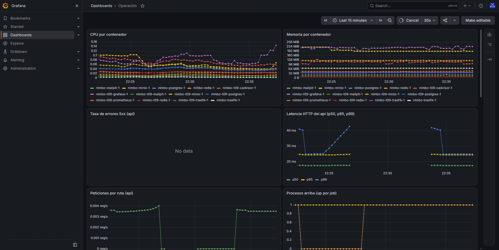

Tablero completo, de 22:29 a 22:44: colas y disponibilidad de dependencias, con MinIO, Postgres y Redis en 1.

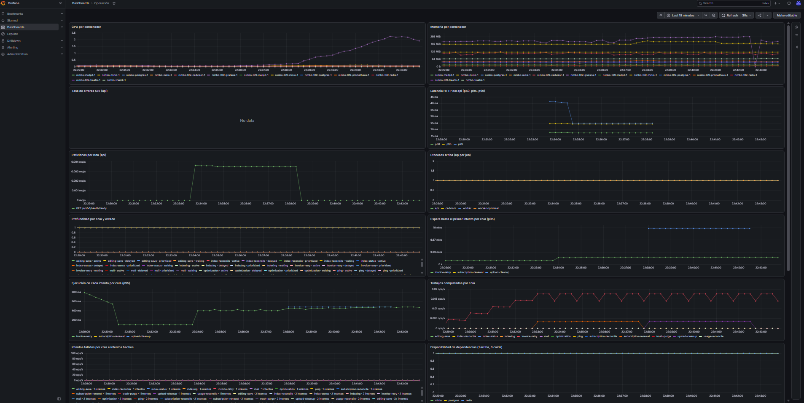

Paneles 12, 14 y 15: renovación en 0, disco del anfitrión con `/dev/loop*` al 100 % (H-1) y disco por contenedor sin datos (H-2).

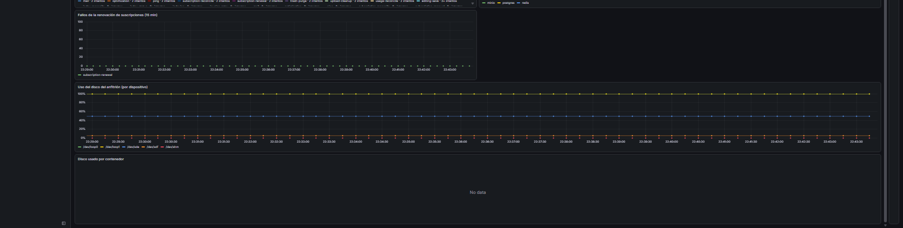

## CA-18: Redis caído hasta el correo

Solo se detuvo Redis de `nimbo-t09`; Postgres y MinIO siguieron en 1.

**Segunda prueba, sin interrupciones:**

| Hora local | UTC | Evento |
|---|---|---|
| ≈ 23:38:30 | ≈ 05:38:30 | Redis detenido; el panel 13 muestra `redis` en 0 (captura 10) |
| 23:40:43 | 05:40:43 | Mailpit: `[FIRING:1] Dependencia caída Nimbo (redis)`, de `alertas@nimbo.local` a `equipo@nimbo.local` |
| — | — | Redis restaurado: responde `PONG` y queda `healthy` |
| 23:45:43 | 05:45:43 | Mailpit: `[RESOLVED] Dependencia caída Nimbo (redis)` |

El correo trae `alertname`, `dependency=redis`, `grafana_folder=Nimbo` y el resumen de la regla, sin UUID ni datos de usuarios. Los workers respondieron `200` durante toda la prueba.

**Primera prueba (21:37 a 21:43):**
- Redis se detuvo a las 21:37:23.
- El `[FIRING]` llegó a las 21:39:43, 2 min 20 s después.
- Redis se reinició a las 21:40:22; `health/ready` volvió a `200` a las 21:40:34.
- El `[RESOLVED]` llegó a las 21:43:13.
- Entre el disparo y la resolución, Docker Desktop se cerró a mano. Mailpit guarda los correos en memoria, así que se perdió el primer `[FIRING]`; por eso se repitió la prueba.

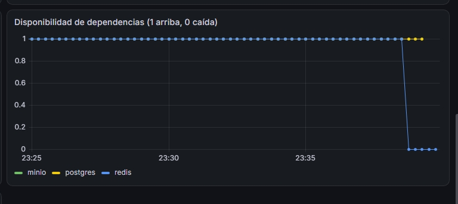

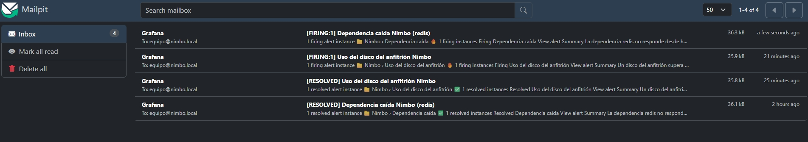

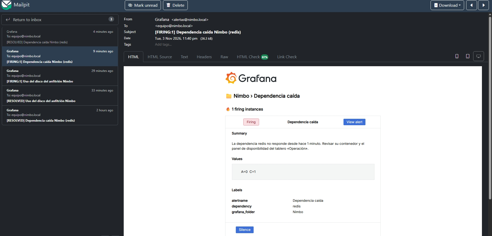

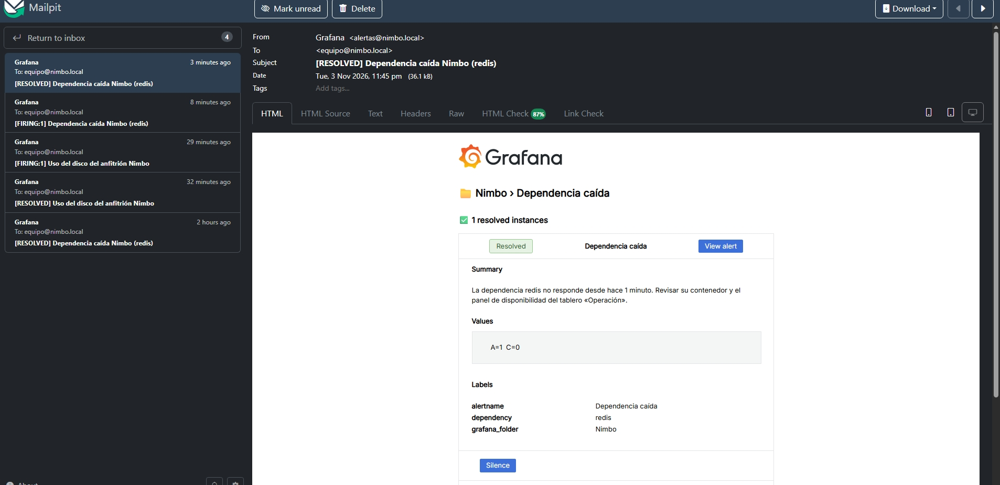

## Segunda ronda (2026-11-04): correcciones y CA-11

Se usó el mismo proyecto `nimbo-t09`, con la configuración de `fd95398a`. Las horas son locales (UTC−6) y las de los correos salen de Mailpit.

### Correcciones de H-1, H-4 y H-6

| Hallazgo | Corrección | Verificación |
|---|---|---|
| H-1 | `e8765667` y `fd95398a`: la regla 4 y el panel 14 excluyen `/dev/loop*` y `/dev/shm` y miran solo el `/dev/*` de mayor capacidad | Abel comprobó en la interfaz que el panel 14 ya no muestra `/dev/loop*`. Mailpit recibió `[RESOLVED] Uso del disco del anfitrión` a las 06:15:15, y la regla aparece en Normal durante CA-11 (captura 15) |
| H-4 | `e8765667`: panel 3 con `or vector(0)` | Antes del tráfico de error, el panel 3 marca 0 % (captura 14) |
| H-6 | `e8765667`: `GF_SERVER_ROOT_URL` en `compose.yml` | Llegaron tres correos `[FIRING:1] TestAlert Grafana` del punto de contacto (06:38:27, 06:38:29 y 06:40:37). Los enlaces de ese correo y del de CA-11 apuntan a `http://localhost:3030/…` (por ejemplo, `/alerting/grafana/nimbo-5xx/view` y `/alerting/silence/new`), que es Grafana. El enlace lleva a `/login` si no hay sesión |

### CA-11: Postgres caído hasta el correo de 5xx

Solo se detuvo Postgres de `nimbo-t09` y se generó tráfico HTTP contra el api, que respondió `503`.

| Hora local | Evento |
|---|---|
| ≈ 06:47:30 | Postgres detenido; el panel 3 pasa de 0 % a 50 % (captura 14) |
| 06:53:40 | Mailpit: `[FIRING:1] Tasa de errores 5xx del api Nimbo` |
| — | Grafana muestra «Tasa de errores 5xx del api» en Firing (captura 15) |
| antes de 06:58 | Postgres restaurado: `healthy`, y `health/ready` del api en `200` (registro 17) |
| 06:58:40 | Mailpit: `[RESOLVED] Tasa de errores 5xx del api Nimbo` |

El `[FIRING]` llegó unos 6 min después de empezar los errores, como corresponde a `for: 5m` más la evaluación de cada minuto.

**Observaciones adicionales.** Durante la misma ventana también dispararon otras reglas. No se investigó qué las disparó ni se afirma una causa:

| Hora local | Correo |
|---|---|
| 06:48:48 | `[FIRING:1] Fallo del proceso de renovación` |
| 06:49:43 | `[FIRING:1] Dependencia caída Nimbo (postgres)` |
| 06:51:41 | `[FIRING:3] Cola con trabajos pendientes o reintentados` |
| 06:56:41 | `[FIRING:1, RESOLVED:2] Cola con trabajos pendientes o reintentados` |
| 06:59:43 | `[RESOLVED] Dependencia caída Nimbo (postgres)` |
| 07:01:41 | `[RESOLVED] Cola con trabajos pendientes o reintentados` |

- «Dependencia caída (postgres)» es el comportamiento esperado de la regla 5 con Postgres detenido.
- «Fallo del proceso de renovación» no tenía `[RESOLVED]` a las 07:05. Su regla se resuelve sola 15 min después del último fallo.
- Tras restaurar Postgres, el api respondió `200` (registro 17). No se midió si hubo una recuperación tardía como la de H-7, que sigue sin caracterizar (PD-189).

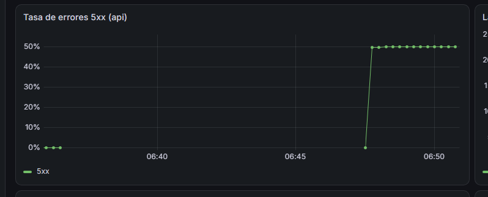

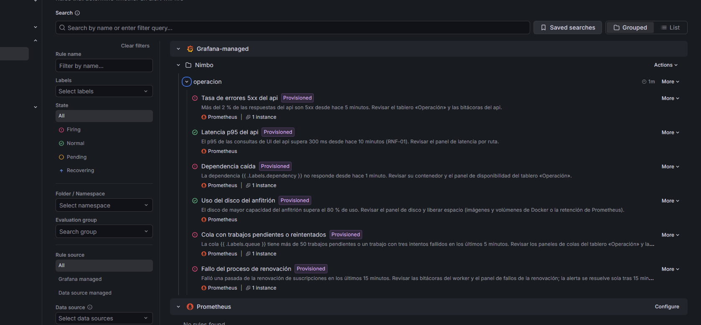

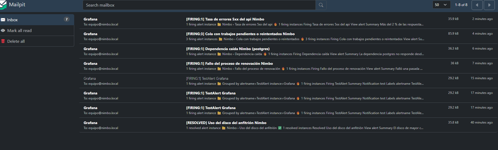

Recuperación de Postgres y del api: [17-ca11-postgres-recuperado.txt](17-ca11-postgres-recuperado.txt). Es una transcripción de la consola, no una captura; se quitó la ruta del perfil local del prompt.

## Hallazgos

Las demos no cambiaron nada. Las correcciones llegaron en commits aparte (`e8765667` y `fd95398a`) y se verificaron en la segunda ronda.

| # | Estado (2026-11-04) |
|---|---|
| H-1 | ✅ Corregido y verificado |
| H-2 | ⏳ Abierto, registrado como PD-173 (comprobar en staging Linux) |
| H-3 | Efecto de la prueba aislada; sin acción |
| H-4 | ✅ Corregido y verificado |
| H-5 | Correcto según CA-3; sin acción |
| H-6 | ✅ Corregido y verificado |
| H-7 | ⏳ Abierto, registrado como PD-189 (reproducir y medir) |
| PD-172 | ⏳ Abierto, confirmado y cuantificado en la demo |

Detalle tal como se observó en la primera ronda:

| # | Hallazgo | Implicación |
|---|---|---|
| H-1 | La regla de disco usa `device=~"/dev/.+"`, que incluye `/dev/loop0` y `/dev/loop1`. En Docker Desktop/WSL2 son imágenes de solo lectura, siempre al 100 %. Los discos reales estaban al 49 % y al 5 %. La regla está disparada desde el arranque y además oscila: se resolvió a las 23:16:52 y volvió a disparar a las 23:20:16 | Alerta permanente y falsa en las máquinas de desarrollo con Docker Desktop. Cualquier alerta real de disco queda tapada. En Linux de staging o producción podría no ocurrir; no está verificado |
| H-2 | cAdvisor v0.60.6 no publica `container_fs_usage_bytes` por contenedor en Docker Desktop, solo `id="/"` | El panel 15 queda vacío y el «disco por contenedor» de CA-3 no se puede demostrar en este entorno |
| H-3 | Los paneles 1 y 2 incluyen contenedores de otro proyecto de Compose de la misma máquina (`nimbo-*` de 021) | Efecto de la prueba aislada. En un anfitrión con un solo proyecto no aparece |
| H-4 | El panel 3 muestra «No data» en lugar de 0 % cuando no hay ningún 5xx, porque el numerador no tiene series | Se lee como una falla del panel cuando el sistema está sano. Se corregiría con `or vector(0)` |
| H-5 | ONLYOFFICE no aparece en el panel 13 porque su perfil estaba apagado | Correcto según CA-3 («con su perfil activo») |
| H-6 | Los botones *View alert* y *Silence* del correo apuntan a `http://localhost:3000`, que es el api de Nimbo, y no a Grafana, porque falta `GF_SERVER_ROOT_URL` | Quien recibe la alerta llega a la aplicación equivocada. Hay que configurarlo en cada ambiente |
| H-7 | **Recuperación tardía del api, sin caracterizar.** Al restaurar Redis en la segunda prueba, `GET /api/v1/health/live`, `/health/ready` y `:9464/metrics` del api agotaron el tiempo de espera durante un rato. Después volvieron a `200` sin reiniciar el api, y luego respondían en unos 20 a 35 ms. Los workers no se vieron afectados. En la primera prueba no pasó: `ready` volvió a `200` un segundo después de que Redis quedara sano | `live` no consulta dependencias, así que el proceso entero dejó de contestar. Si eso dura más de unos 60 s, el *healthcheck* de producción (`ambientes.md`) marcaría el contenedor como no sano, y Prometheus pierde el objetivo `api` mientras tanto. **No se midió la duración ni se demostró una causa.** No está documentado en la spec, el runbook ni `pendientes.md`. Propuesta: PD-173 para medirlo de forma reproducible (Redis detenido 3 min, sondeo cada segundo de `live`, `ready`, `/metrics` y `up{job="api"}`) |
| PD-172 | Ruido `ECONNREFUSED` con Redis caído (primera prueba): 4886 líneas en unos 3 min. En los primeros 2,5 min fueron 3489 del worker, 785 del api y 198 del worker-optimizer. Solo unas 250 son líneas de Pino (unas 55 por minuto); el resto son trazas crudas del cliente de Redis, fuera de Pino | Confirma PD-172 y lo cuantifica: ahoga la consola y las bitácoras durante cualquier caída de Redis |

## Decisiones pendientes (Matul)

Ya resuelto por las decisiones del 2026-11-04 y verificado: H-1, H-4 y H-6 se corrigieron en 022; H-2 pasó a PD-173 y H-7 a PD-189; CA-11 se ejecutó y fue aprobada. Adrián las resolvió el 2026-11-10: CA-3 queda parcial por PD-173, PD-189 no bloquea y T-09 se marca completada. Planteadas así:

1. **CA-3 con PD-173 abierto:** si se acepta que el «disco por contenedor» se compruebe en staging Linux, o si bloquea la T-09.
2. **PD-189 (H-7):** si se puede cerrar la T-09 con PD-189 abierto.
3. **Cierre de la T-09:** si con lo anterior puede marcarse completada en `tasks.md`.

## Estado final de los servicios

Al cierre de la segunda ronda (2026-11-04, alrededor de las 07:00), Postgres estaba `healthy`, `health/ready` del api en `200` y los workers en `200`.

Al cierre de la primera ronda (2026-11-03, 23:5x):

- **api:** `health/live`, `health/ready` y `:9464/metrics` en `200`, en unos 20 a 35 ms.
- **worker y worker-optimizer:** `/metrics` en `200`.
- **Contenedores de `nimbo-t09`:** Postgres, Redis, MinIO, cAdvisor y Mailpit `healthy`; Prometheus, Grafana y Traefik arriba.
- **Reglas:** «Dependencia caída» en Normal. «Uso del disco del anfitrión» sigue disparada (H-1).
